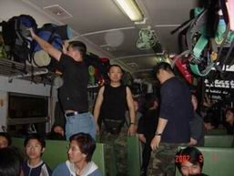

# 五月的旅行（一）

五月一日晚上22：17分的2521次列车开往绩溪方向，硬座普快票价25元。候车室里人山人海，基本上都是外出旅游的年轻人还有车站上随时都可见到的农民工兄弟。这种形式的旅行使我不免有些得意，但是当我见到火车车厢两边的行李架上放得满满的背包和野营用具时，方才知道自己并非什么标新立异的一族。  
  
我的背包和同行的伙伴们的背包放在一起整个是孙子和爷爷的感觉，我并没有为这次旅行特意购买登山包，只是随便拿了去年公司集体旅行去黄山时发的普通背包来用。我打算在火车上睡觉的，可是到了凌晨3：34分伙伴们仍然兴奋的说说笑笑，好象还在玩什么“杀人”的游戏，恍惚间感觉他们还特认真地作着案件分析。只有我一人坚持平时的作息时间在午夜12点前靠在窗户上强制自己睡觉。火车多次在不知名的小站上停留，每每我们都会将脑袋伸出窗外好奇的张望一下，顺便呼吸呼吸车厢外面新鲜凉爽的空气。  
  
5月2日，早上5：20抵达绩溪火车站，雾很大。从车站出来步行大约20分钟左右，我们在路边的一家叫“吉强”的饮食店准备吃早餐。两间房间，里面稍微干净一点的房间全被我们和我们的背包占据了，等吃饭的工夫大家赶紧洗漱。早餐还算丰富，有稀饭、鸡蛋、馄炖，还有受到我们欢迎的笋子饼。  
**（待续）**
