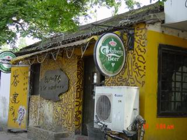

# 寂寞咖啡之5月18日

现在是午夜1：40分，我睡意全无。  
  
晚上和GRACE去南大听刘家琨的讲座，他是个建筑师，1984年毕业之后仅做了一个工程的设计就开始过自由的生活：写作。直到1990年才又回到他的本行中来。用他的话讲，做自己的专业，越专业越好，如果可以从自己的专业中跳出来，到其他行当转转，这样可以从不同的角度更好的去理解和诠释自己的专业设计。  
  
   
  
听完老刘GG的演讲从正对南大正门的教学楼出来，和GRACE步行到南大生活区，突然在今夜，对这座校园有了很多的感觉和感情。虽然前男友JOHN是从这里毕业的，可我从未对他的母校有诸多深刻的印象，想必是那时太迟钝的缘故吧？！  
  
  
——路边新做的指示牌。哦，“强化部”在东大楼。JOHN后来念的是物理理论专业，听说物理专业的学生最聪明。原来那时侯的我是自作聪明啊？！  
  
我对南大的印象之一：他的妹妹当时还在南大的外语系念书，有一次她在路边的过道上拴了一张网，和她的同学打羽毛球来着，我和她哥哥骑车路过时，满脸是汗的她穿着一件红得耀眼的汗衫远远的朝我们挥手；  
  
印象之二：生活区南门旁边的网球场。刚工作那会儿，JOHN和我经常在这里打网球，我们一起到新华书店买指导初学者如何打网球的书。每每路过那个网球场，几年前那些晴朗的下午，我们和同事在网球场上打网球的情景马上从记忆中跳出来，清晰可见；  
  
印象之三：那会儿，JOHN才工作第二年，经常回南大和他上研究生的同学一起聊天一起玩。他告诉我他们强化班40个学生，当时就只有5个人在国内或工作或上学，其余都出国深造了。那时侯我认为南大的学生好厉害！同时因为他，我对理工科出生的人很有好感也很有安全感。  
  
  
——南大运动场  
  
出了生活区是广州路，夜市上的小商品摊子零星的占据着人行道的边缘。上次来这里是四月一个星期六的下午，漫天飘着梧桐树上的小毛毛，有点风也有点热。我在广州路上的一家小店里挑音乐碟，一个朋友正好打电话给我，假惺惺的嘘寒问暖一番，当时我真想跑过去看看他装模作样的表情。  
  
走着走着，看见街对面的“川香元食府”，恩，那也可以算做我对南大的印象之一吧！96年，JOHN带我来吃这家的四川小吃，那时的川香元食府猥琐的缩在广州路肯得基快餐店那个路口的东面位置上，外面搭了一个简易破旧的棚子，屋内几张油呼呼的桌子、凳子。好象店名不叫现在这个名字，叫“赖汤圆”什么的。那时侯我还不能吃辣，所以吃的时候，脸一直红嘴唇发麻，搞得我在他面前更加窘迫。（据说能吃辣的人可以做一家之长。）JOHN告诉我，他和他的同学都喜欢这家店的口味。1998年我开始频繁支持“赖汤圆”在金鹰购物中心美食广场的餐饮事业。不仅因为我喜欢上四川菜的口味，另一个原因是用餐的同时，顺便看看“赖汤圆”那个赏心悦目的年轻老板。他经常一个人坐在客人用餐的座位上，看看报纸或者用他单眼皮的眼睛酷酷的看着来来往往的客人。后来再没有见到他，听说他的老婆生孩子他回家去了。  
  
**... ...**  
  
我尽量放慢脚步好延迟离开南大的时间和距离**......**  
  
  
——留学生宿舍  
  
  
——这是我喜欢的“答案”酒吧，靠近南大。酒吧的老板养了好几条狗，还有高大的猎狗。他们家的狗狗象他们的主人一样具有自由随意的气质，不怕生人。有一公一母的小狗狗，主人从不拴养，任他们在酒吧里来回走动玩耍。只要有机会我都会上前拍拍他们的脑袋，有时为了抱一下还得帮他们挠痒讨好他们。据说后来那条公狗和别的狗狗私奔了！（私奔？恩，应该是很浪漫的事情吧？！）这些狗每天在酒吧里听流行乐和轻摇滚，想必一定很有音乐细胞，呵呵！  
  
“答案”酒吧曾经有个男歌手，剪着整齐的刘海，后面扎了个独辫子，很清瘦的模样。听说当时他在攒钱准备做变性手术。有一次我去那里“醉生梦死”，果真看见他隆起的胸部，并且是非常彻底的女性化打扮，我马上狠狠地想象：如果...如果...要是...怎么办？再之后去“答案”一直没有再见到“她”！
