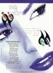

# 一个人的视线（写于2001-08-25）

  
  
昨天是三伏天的最后一天，刚刚学了美语里“三伏天”的单词，在家看《Sword Fish》，片子开头部分听到主人公说“dog day”这个单词，现在对三伏天的这个单词应该是不会忘了的。所以今天异常的凉爽，不冷也不热。刚巧今天又是外婆去世42天，家人早早起床，不知道在忙些什么，或许是我并不想知道他们在忙些什么吧。骑了自行车没有计划性的外出了，如果不出去转转真的很对不起这么凉爽的天气，另外一个原因也是心情使然。不知不觉得就骑到那所经常散步的校园。  
  
寥寥无几的行人，高大茂密的梧桐树将这条校园的主干道装饰的很幽静，唯一嘈杂的是穿堂而过的秋风。我骑车路过那些宿舍区到达操场。所幸的是操场上也同样的萧条和冷清，它没有我想象得那么大，虽然我曾经不止一次的穿越和行走在上面，并且它承载着我不为人知的心情。我将车停靠下来，翻身坐在路边的水泥护栏上，面向操场，身后是一排整齐的松柏树，松柏的枝叶覆盖在我头顶一米左右的距离。这里不会有人经常路过，因为路的尽头交通不方便或可以说是死胡同吧。所以我喜欢选择坐在这里，这里很安静，安静只可以聆听自己心跳的声音。操场上长满绿草，非常葱翠的颜色，并没有因为秋的到来而黯然失色，这是一个很不错的足球场地，南北向都有两个球门，茂盛的草地在学生返校之后必会衰弱下去。我享受这情景代给我的心情，坐在这平日里那些浮躁的情绪会渐渐沉静下来。莫名的感动起来，一种温热的液体漫溢在眼眶中。  
  
没有原因！
