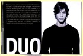

# Mr. Right

    
你相信「Mr. Right」存在，还是「Mr. Rights」不存在？也就是说理想的伴侣真的就那么一个吗？还是有很多个呢？往往许多人在抉择伴侣时，容易东想西想，(不知所措，就是因为害怕一时做错决定，看错人，造成终生的遗憾。  
  
诺贝尔文学奖得主萧伯纳说：「此时此刻在地球上，约有两万个人适合当你的人生伴侣，就看你先遇到哪一个，如果在第二个理想伴侣出现之前，你已经跟前一个人发展出相知相惜、互相信赖的深层关系，那后者就会变成你的好朋友，但是若你跟前一个人没有培养出深层关系，感情就容易动摇、变心，直到你与这些理想伴侣候选人的其中一位拥有稳固的深情，才是幸福的开始，漂泊的结束」爱上一个人不需要靠努力，(只需要靠「际遇」，是上天的安排，但是「持续地爱一个人」就要靠「努力」，在爱情的经营中，顺畅运转的要素就是沟通、体谅、包容与自制(面临诱惑有所自制)。有许多人总是为「际遇」所迷惑与苦恼，意念不停、欲念不断、争逐不散，而忘了培养经营感情的能力才是幸福的关键。所以不要去追问到底谁才是我的Mr. Right，而是要问说在眼前的伴侣关系中，我能努力到什么程度、成长到什么程度，若没有培养出经营幸福的能力，就算真的Mr.Right出现在你身边，幸福依然会错过的，而活在犹疑与遗憾当中，这不就是许多「爱情虚无症」的遭遇与心态吗？  
  
若你此刻已有一位长久相伴的伴侣，不要再随便三心二意地犹疑了，我们往往不易察觉感情中的一个陷阱，就是「近亲生慢侮」，也就是经济学中的铁律「边际效益递减法则」，跟你在一起越久的人，就越容易麻木与忽视，而新鲜的「际遇」总是那么动人可爱。  
  
在感情对待中，难免有摩擦与无心的伤害，而且论得罪自己的次数累加起来最多的人，当然是跟我们在一起最久、最亲近的人。而新欢呢，又还没开始有得罪你的机会，再加上他的刻意讨好，所以新欢怎么看怎么可爱，旧爱怎么看怎么讨厌。但别忘了，新欢身上总是有不确定的未知数，旧爱身上就是有难得的熟悉感、确定感、信赖感。千万不要随便在偶然的「际遇」中迷失了自己，错放了幸福温暖的手。  
  
所以萧伯纳的话，是要提醒情人不要太钻牛角尖于寻觅那唯一，应该把精神用在学会经营幸福的能力上，同时也提醒我们「溺水三千 只取一瓢饮」若有幸遇到了难得的伴侣，就不要再三心二意了，因为我们永远不知道一生何时会遇到两万个其中的几个 ，所以要知福惜福 、活在当下。  
  
 *勇气  
终于作了这个决定  
别人说我怎么不理  
只要你也一样的肯定  
我愿意天涯海角都随你去  
我知道一切不容易  
我的心一直温习说服自己  
最怕你忽然说要放弃  
爱真的需要勇气  
来面对流言蜚语  
只要你一个眼神肯定  
我的爱就有意义  
我们都需要勇气  
去相信会在一起  
人潮拥挤我能感觉你  
放在我手心里  
你的真心*
