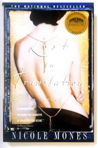

# 身体上的国境线

去年，我看了2001年第二期《收获》杂志上的一篇长篇小说《身体上的国境线》，作者为贺奕。为这篇小说我陶醉了好几个月。作者描述小说里的人物的内心微妙变化和感受，和我本人心灵有着很多次的不期而遇。特拿来与君分享！  
   
PAGE 143  
　**那不是一段普通的感情，也就是说，它不会以人们常见的方式淡漠、枯朽和变质。那甚至不是情感本身，难以给它一个确切的命名。**站在首都机场一层大厅标有“国际到达”字样的绿色灯牌下，我注视着正从通道鱼贯而出，形形色色的中外旅客们。从幼年开始，**对火车站、机场和码头这类地方，置身于刚刚抵达或正待启程的人流当中，我就总会产生前程未定、归宿不明的空虚感，而这正好切合了我对自己以及人生根深蒂固的看法。**  
  
PAGE 147  
**“我只是有种模模糊糊的感觉：虽然我们看上去天差地远，骨子里却可能属于同一类人。”**  
“哪一类人？”  
她仰起头。这时她的脸刚好隐匿在一片阴影里。  
“如果你真感兴趣，我想，我想很快就会弄清楚的。”  
  
PAGE 148  
……我的口气那样轻松，飘飘然以至于几乎忘了，我的业余时间乃至全部个人生活，充其量只是受着心血来潮、惰性和挫折感的交替摆布罢了。  
不过，**在我们交谈中不断显现出的差异，不仅仅没有形成隔阂，相反，对于两颗素昧平生、不期而遇的心灵恰好还起到了相互感化的黏合作用。正是这些差异，使依莎贝塔和我同时萌发了深深的迷恋，断续的沉思，一种似乎要将它们捧置手心反复摩挲和把玩的兴趣。**  
  
PAGE 149  
　　**在那以后，我们接吻了。**与其说是两个人相互吸引的结果，倒不如说，它是我们相互表达由衷感激的方式。它将馈赠和接受融为一体。如果在月光的朗照下，在如沐如浴的也色中，在历史的小小遗址上出现了一对青年男女，**对于这样一个夜晚而言，接吻理所当然会成为其中的一个天然部分。我们所要做的，所应做的，所能做的，就是让它毫无保留地呈现出来**。……全都迷失在莫名的怅惘中。他们不再以自身以外的任何东西作为存在的理由和追求的目的。**既不是为了制造愉悦，也不是为了获得理解。仅仅是生命能量如一缕缕水汽向着虚无的不断发散而已。**  
  
PAGE 151  
“……在我，可能是出于认为我们是同一类人的错觉；在你，可能是想要给你的中国之行划一个不寻常的句号。但开始得快的东西往往结束得更快。也许这是注定了的。“  
……**或许是因为连我们自己也意识到两人的关系过于飘渺空洞，而想让它更多地附着在某些相对坚实的事物上吧。**一开始是石碑，然后是红墙、铜炉、汉白玉、玻璃瓦什么的。可是，**在和三五天的情感波澜相比，历史真象我们以为的那般坚实么？**…….“知道这会儿我心里最大的愿望是什么？”我茫然地摇头。“**就是四周一个人也没有，只有我和你在这片高高的平台上做爱。”奇怪的是，从她的话里感觉不到丝毫淫靡的意味。**那时我们正走在中和殿到太和殿之间熙熙攘攘的人流里。  
  
PAGE 152  
……**我猛然悲哀地意识到，她已经把我身上辛辛苦苦得到的一部分对于生存意义、对于人情世故的认识，不留任何痕迹地永远带走了。她一点不清楚，正是和她偶然而短暂的遇合，使得我的生活在一阵剧烈摆荡之后偏离了惯常的轨道，并进而坠向茫茫无尽的虚空：她的柔情是整个过程中最残酷的部分。**  
……依莎贝塔，你该谢的不是我。要谢就谢将人与人分割开的时间，要谢就谢将人与人分割开的空间吧！在飞机的航线变得象天际一样模糊，在纸上的墨迹黯然枯朽，在无数次的日升月落，斗转星移之后，要知道，再不会有一种叫做思念的东西来折磨人的心灵了。  
  
PAGE 153  
…..遗憾的是，与依莎贝塔的久别重逢没有为解开我心头的疑团提供丝毫线索。只有一点无可否认，她在我心目中（主要是通过回忆构筑起）的形象正在一点点地瓦解。在我的感觉中她变得更加陌生了。陌生到我们之间似乎不曾有过任何瓜葛。  
然而，最使我感到困惑的方面，并不是在依莎贝塔，而在我自己。如果说，**以前我还可以佯装对自己的空虚和堕落视而不见，那依莎贝塔的出现等于打开了一面雪亮的镜子，将我这几年来心性上的蜕变暴露无遗。**的确，我再也不是依莎贝塔见过的那个不谙世故，自命不凡，喜欢远眺和沉思，对感情创伤既恐惧又着迷的家伙了。……我渴望成功的雄心正在日渐淡薄。那么，我为此感到羞愧吗？依莎贝塔一定不会想到，如今的我安于平庸、浑浑噩噩的是生活，**简直就像一滴油浮在水面那么的自在**。  
  
PAGE 158  
“……**爱情是一种必然会被时间磨损掉的东西，因此每一个男朋友在你生活中都会成为过去。**友情却不一样，它没有爱情那么极端和苛求，所以比爱情更为持久。只有友情值得你花一辈子去保持和珍惜。一个真正的朋友意味着他在你生活中的每一个阶段都是朋友。……**作为朋友要比彼此相爱或者不再来往都更有意义。”**  
  
PAGE 159  
……**如果存在一种真正的爱情，我相信它应该是使人积极的，而不是使人沮丧的。真正的爱情能给人一种成长的感觉。**…  
  
PAGE 205  
…“我还得要问，**为什么有人会迷恋那种感情上的漂泊无依的感觉呢？”**  
　 “这个嘛，就等于是问为什么有人会迷恋旅行一样。为什么有人会迷恋旅行呢？我想是因为他们觉得自己的日常生活过于平庸乏味，眼界过于狭小，希望暂时从中摆脱出来。他们希望能够看到奇异的风光，体验到新鲜的乐趣，这会使他们觉得自己的生活有了某种程度的转变。我也喜欢旅行，但是和其他人有所不同的是，我发现和人的相遇也能让我感到处于一场旅行当中。可能是和朋友相对而坐一起聊天，也可能是与人在床上一起缠绵。**男人和女人的相遇尤其像是一场旅行，而如果他们从相遇的开始就注定会要分手那就更像一场旅行了。……**  
  
PAGE 206  
“……**爱情表面上花团锦簇，其实却是集人类各种阴暗心理之大成的渊菽：嫉妒、猜疑、自私、诱惑、欺诈、虚荣心、占有欲乃至仇恨。想想看，古往今来，多少人间悲剧因爱情而起。”**  
“可是你还是很看重爱情，不是吗？”  
……  
“这是因为什么呢？”  
“我**想是懦弱吧。**”卡罗琳说，“**在这一点上，我好象没法让自己坚强起来。……**  
  
PAGE 208  
　　云端之上的她是否明白，**从今后我将不再困惑于爱的本质**，**而只会困惑于怎样才能象爱她那样，去爱**任何一个别的姑娘呢？
