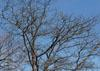

# 黄昏旅途

作者: **长发和尚**  
  
黄昏旅途  
2002年6月16日(这是场没有终点的旅途,开始和结束都存在于不经意间.)  
  
**前因**  
  
一条河,  
如生命般清澈,而又苍白的河,在梦里灵光一现,恍然白驹过隙.  
蜿蜒的曲线追逐华年的消逝,两岸唏嘘的灵长,沉默的沿河而下,不知最终的结局.  
这是段没有终点的旅途,所有的开始和结束都在不经意间.  
  
  
  
**旅途**  
  
白天里被病痛折磨的死去活来,  
黄昏,突然很想出去,虽然依然难受。  
不知道去做什么,就是想出去.  
沿雨山路往西走,在和江东大道交叉的路口,想起南面未曾经历的所在,便折了过去.  
很久之前去采石和向山也如这次一般,只是沿着路一直走一直走,并不知道路的尽头在哪里,或许尽头就是心间的倦迨，而已。  
倘若不是心情的缘由,这些地方也许我一辈子都不会来,想想真是悲哀,世界这般大,而我们却不得不寄居一处,老死寡所。  
那些陌生的人和陌生的事似乎永远都和我们无关.”虽鸡犬相闻,却老死不相往来。”  
我想和他们干连。  
  
渐行渐远,地方也愈发的荒凉。  
然而,就是这份荒凉却滋生出天地的宽广.天与地接近的令人胆战心惊。  
夕阳很美。  
无遮无拦的西天制造悲壮的气氛,就着荒凉的悲壮岂非更加摄人心魄。  
几只飞鸟一掠而过,替悲壮的底色抹上一丝灵动的色彩。它们是归鸟,我说。  
可谁又知道它们是不是真有归宿呢?抑或,只是如我这般无目的的行走，而已。  
  
路,转了又转；人,换了又换。  
我知道,我终于迷路了;我知道,正遂人愿。  
晚霞亦若如人,此刻,便是垂暮之时,绚烂到了极至。  
我知道,它即将老去;我也知道,它的光华已存在万物之心。  
人生于世,夫复何求。  
  
我站在桥上，目光清澈如水。  
夕阳消散了光华,我用心底的记忆张望。  
桥下就是梦里的河水,河床宽广,水质清澈,只微微泛着漪沦,恍然情人的手臂,温柔的一掠便过去了。  
河应该是很长的,因为我看不到头,为什么不去瞧呢?  
于是溯流而下,恍惚里,伊,就在对岸，遥遥与我相望。  
“蒹葭苍苍,白露为霜.所谓伊人,在水一方.溯游从之,道阻且长，溯洄从之,宛在水中央。”  
  
就这么与伊在两岸奔走,暮色却在不经意间跌进眼帘。  
太多的不经意了,也许我们都有些厌倦,人世有时是需要些刻意的。  
我们之间真的便隔了条河。  
一条没有终点的河。  
所有的期待和热情只能融化在彼此若即若离的眸中,从日出到日落,从沧海到桑田,心的河永远也越不过。  
  
忘了走多远,似乎连呼吸都变的极陌生起来。  
一座又一座的山,一片又一片的田地,除了这条河。  
我沉侵在陌生带来的庞大冲击里.我是个喜欢在陌生里游弋的鱼。  
早已没有了暮色,隐约窥见远处一抹山峦里露出塔楼的影子,只一眼,便记起”雷峰塔”来,南屏山对面的”雷峰塔”,暮色里难言的一股憔悴。  
据说,当年雷峰塔倒塌的时候,砖瓦间尽是佛经,可惜,却不爱佛的杭州市民抢劫一空。  
于是,童话破灭了。  
于是,另一些人继续寻找。  
他们离不开童话,确切的说是离不开单纯。  
——这世上如今还有人单纯吗?
