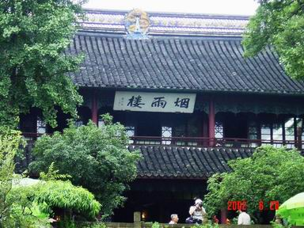

# 想你

  
  
这样的夏天  
这样的夜晚  
这样的感觉  
应该  
算作  
想你  
  
想你是一种情绪  
轻柔的弥漫  
淹没我  
陷入灼热的空气  
带出上个冬季的回忆  
  
想你  
是一种姿态  
临风的伫立  
哪堪你一回首的风情  
陷入不觉爱意的思念  
  
想你是一种习惯  
不倦的重复  
想你  
想你  
重复  
  
孤寂的夜  
想你不能自己  
当我已不再爱你   
  
*——我心已死　　无力再爱 　哀莫大于心死*
