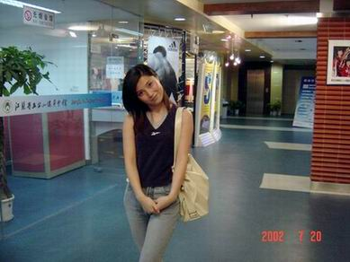

# 偶遇

如何在凌晨的时候保持清楚的头脑去写点儿心里的故事，一直很难！怕此时不写明早只剩下一颗空心了。不得不写点什么。  
  
傍晚到一直健身的会馆去游泳，记次卡还有四次就要结束了，在前台时买了半年卡，以后想一天去会馆10趟都行（俨然象是占了便宜的嘴脸哦？！）其实不然，若没有时间同时也没有毅力的同志还是不要买不记次数的会员卡，这样比较划算。今夏对于我来讲，比往年多了很多的意义，今夏我开始游泳了，且到了一个好地方，至少在你游泳的过程中不会因为泳池拥挤而频频停下来，可以拥有蓝色清澈的水，沐浴的空间和面积很是明亮宽敞。锻炼也应是一种特别的享受。  
  
  
——小羽在会馆的前厅，她目前正在北京广播学院读研究生。  
  
刚上电梯，遇见南京电视台体育节目主持人朱凯、夺冠节目原主持人小羽，还有朱凯的弟弟。小羽是我中学低我一界的校友，因同在校舞蹈队活动，同时也是队友。在我印象中的小羽体型微胖，眼睛大而明亮，说话时声音通过脑门后面到达鼻子发出来的，就是声乐里美声唱法的发音方式，有点那个味道。后来小羽真的在南艺学习了四年声乐。成年的小羽俨然是个活脱脱的美人了，比她小时侯更有吸引力。  
  
锻炼完时间已经将近20：00，索性和他们一起去星汉大厦那边的“小草屋”吃韩国料理，可能是饿了的缘故，我从来就不喜欢吃的韩国料理今晚却尤为的好吃。  
  
——这些小菜全是老板的姐姐亲手腌制的，味道还不错！  
*（**未完，待续，实在是太瞌睡了。）***
