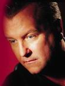
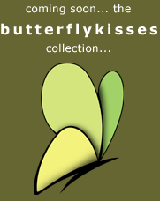

# Bob Carlisle《Butterfly Kisses》

这是**a visitor** 给我那篇《DIANA KRALL》的留言，完全可以作为独立的文章上传到主页上。看他对《Butterfly Kisses》的介绍，不尽也有感动的地方。  
  
作者：**a visitor**    
  
如果你能接受轻摇滚话,美国乡村歌曲绝对OK了.那么再重点介绍介绍Bob Carlisle演唱的Butterfly Kisses。  
  
Butterfly Kisses是指用眼睫毛 (eyelashes) 象翅膀一样地在另一个人的面颊或是睫毛上拍打，常是大人亲热孩子的举动。中文里没有相应的词，暂且翻译成“蝴蝶之吻”好象也说得过去。台湾的滚石唱片1998年底出过一个英文CD叫“SMASH强打旋风”，用Butterfly Kisses作压轴歌曲，他们把Butterfly Kisses翻译成《蝶舞》，好象有点太写意了？！  
  
美国抒情乡村歌手Bob Carlisle在他女儿Brooke十六岁的生日前夕，看着女儿长大成人了，不久就要远走高飞了，感慨万千而写下了这首歌。BOB以沉稳柔情的嗓音，伴以吉它委婉的合眩，深邃真情的唱出了伟大的父爱。歌中唱到一个父亲对女儿从小到大的很多美好回忆，最动人最难忘的就是那每日睡前祷告後的”Butterfly Kisses”。同时他想到女儿今后结婚时的情景，当想到她婚礼后就要改为夫性，婚礼前当他注视女儿时，女儿问爸爸在想什么，“我不知道，我只是觉得我将失去我的乖乖女”...女儿最后给了爸爸一个“Butterfly Kisses”... “Daddy, 别哭”...  
  
我不在这里翻译了，传达不出那个意境，你自己听或看歌词原文吧...  
  
这首歌把一个父亲对女儿的爱写得感人致极。旧金山的San Francisco Chronicle报的报导说，边开车边听此歌的听众把车子停到路边，泣不成声...不瞒你说，我也曾经听这首歌听得我满眼泪花。现在这首歌已经成为美国婚礼上必放的歌曲。  
  
这首歌灌成唱片後，在排行榜上扶摇直上，成为流行歌曲在流行音乐（pop）台、乡村音乐（country ）台、轻音乐（easy-listening）台等Top 40电台上面高居“热门”榜首。唱片成为1997年夏季销售的第一名，卖了两百多万张。1998年获得了第四十届格莱美（Grammy Awards）最佳乡村歌曲奖。Bob被称为抒情天王是美国專輯榜、成人抒情榜、福音歌曲榜排行三冠王。  
  
顺便一提的是，台湾歌手顺子前两年写过一首爵士歌曲也叫“Butterfly Kisses”，是写给一位她认识三、四年，却没有“追到手”的男人的。我看过顺子的一个MTV，对她印象还可以。可是她竟然不知“Butterfly Kisses”是什么意思，也不知她是没听过97年Bob Carlisle这首顶顶大名的歌曲还是故意冒用名作之名？  
  
  
Bob Carlisle – Butterfly Kisses  
  
There’s two things I know for sure.  
She was sent here from heaven, and she’s daddy’s little girl.  
As I drop to my knees by her bed at night,  
She talks to Jesus, and I close my eyes.  
And I thank God for all of the joy in my life,  
But most of all, for…  
Butterfly kisses after bedtime prayer.  
Stickin’ little white flowers all up in her hair.  
“Walk beside the pony daddy, it’s my first ride.”  
“I know the cake looks funny, daddy, but I sure tried.”  
Oh, with all that I’ve done wrong, I must have done something right  
To deserve a hug every morning,  
And butterfly kisses at night.  
Sweet sixteen today,  
She’s looking like her momma, a little more everyday.  
One part woman, the other part girl.  
To perfume and makeup, from ribbons and curls.  
Trying her wings out in a great big world.  
But I remember…  
Butterfly kisses after bedtime prayer.  
Stickin’ little white flowers all up in her hair.  
“You know how much I love you daddy, But if you don’t mind,  
I’m only going to kiss you on the cheek this time.”  
With all that I’ve done wrong I must have done something right.  
To deserve her love every morning,  
And butterfly kisses at night.  
Tag  
All the precious time  
Like the wind, the years go by  
Precious butterfly  
Spread your wings and fly  
She’ll change her name today.  
She’ll make a promise, and I’ll give her away.  
Standing in the bride room just staring at her,  
She asked me what I’m thinking, and I said “I’m not sure,  
I just feel like I’m losing my baby girl.”  
Then she leaned over….and gave me….  
Butterfly kisses, with her mama there  
Sticking little flowers all up in her hair  
“Walk me down the aisle, daddy, it’s just about time”  
“Does my wedding gown look pretty, daddy?” – “Daddy, don’t cry.”  
With all that I’ve done wrong, I must have done something right  
To deserve her love every morning,  
And butterfly kisses  
I couldn’t ask God for more, man, this is what love is  
I know I’ve gotta let her go, but I’ll always remember  
Every hug in the morning, and butterfly kisses…
