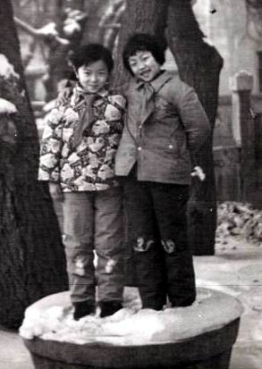

# 你的野蛮女友

在我长久不厌其烦的要求下,终于拿到《我的野蛮女友》的歌曲刻录盘。此行为多少带有恶作剧的企图，想在别人饱含深情的记忆里探探脑袋做个鬼脸什么的，这个夜晚当我在橘色的灯光下踌躇不决得凝听时，由不得你在意也由不得你不在意，那是一种温柔的伤痛！  
  
在如今的不谈爱情的时代，任何有关爱情的描写总是显得虚比浮词。对于爱情以及相关的种种表征，在过去一段不算短的时间里我确实已感到陌生和隔膜。我凭着不可靠的记忆和残存的笔记来勾勒我真正意义上爱过的男子的形象，虽然那短暂的罗曼史以偶然和俗气的方式突然结束，但是其中有一种纯美的体验，却是大多数人所不曾经历过的。我最初的感情是那么的清纯、柔美，具有梦幻的性质，以至消融了我的个性。是否那种与性无关的爱恋才能完美的存在于记忆中呢？而有的爱情正如在《巴黎圣母院》中，艾丝米拉达爱上了菲比斯，虽然一方不过是一个肤浅的花花公子，却在另一方激起了壮阔的，足以吞没生命的情感波澜。  
  
关于爱情最古老的解释，在茫茫人世间寻找自己的另一半，这或许只是孤独的永恒的幻想，然而，另一半是不可辨认的。你的另一半是一个远远的虚幻。这就是悲剧，无穷无尽。这让我觉得可怕！我们和自己相处多年的恋人凭着惯性走下去，有一种痛彻骨髓的，撕不开的力量，使我们不能决绝地轻易说分手。我说不清这究竟是一种什么样的力量？或许我向这个世界索要的太多了。  
  
找到自己小时侯的一张照片，我出生在新疆乌鲁木齐市，那是我在医学院小学的同学，早已忘了她的名字，这张照片于我非常珍贵，因为我小时侯的照片不多。如今想到新疆感情已支离破碎......  

