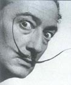
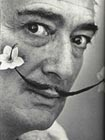

# 达利生平及作品

萨尔瓦多-达利(SalvadorDail)，1904年5月11日生于西班牙菲格拉斯，1989年1月23日逝世。西班牙超现实主义画家和版画家，以探索潜意识的意象著称。与毕加索、马蒂斯一起被认为是二十世纪最有代表性的三个画家。  
    
  
——[“妄想达利”网上展？！](http://culture.163.com/editor/020718/020718_63789.html)  
  
——[达利生平及作品简介](http://art.online.ha.cn/sutra/dali/dali-index.htm)
