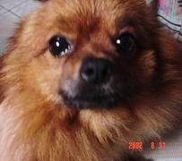
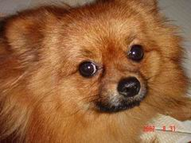

# 偶家狗狗

—南京今天农历十一月初四周六,白天小到中雨转雨加雪,东北风5-6级,最低温度2度,最高温度7度。刚起床，觉得冷，有点冻手的感觉了。  
  
偶们家的狗狗正为滚进沙发下面的彩色小球哀号。每天早上偶最先感觉到的就是它，不是在偶关起的房门外冲着靠近的人发威，就是趴在偶的床头试图舔偶的脸。够不着便企图往偶的床上跳，可惜它的身材属于迷你型的。  
  
狗狗最初的玩具是偶用旧了的网球，褪了色绒毛已被磨去不少，弹性依然，它最喜欢的游戏是你把球抛出去，它去拣，然后让你在后面追它，抢过来再扔。后来朋友在夫子庙买了四只彩色小球送给它做玩具。那段时间家里地面上洒落着各色小球，没有人陪它玩时，它就自己用嘴叼着抛起来，再用前爪去拨弄小球，或者四脚朝天抱着球在地上滚来滚去的。看见偶们回家了，狗狗马上会叼着小球跑到偶们面前，往你面前一扔，眼睛渴望地看着，意思是希望偶们能陪它做会儿游戏。  
  
狗狗的性格也需要培养，如果家里一直没有人陪它，它的性格会变的孤僻；经常被训斥的狗狗，容易激动容易对人产生敌意。偶老妈倒是经常训斥它，所以每每见了偶老妈，狗狗总是先作出防备状，也极少和偶妈妈亲近。偶有时候对着偶家狗狗唱歌，它的脑袋从左歪到右，从右歪到左，那模样可爱极了，那表情似乎在问：“你究竟在说什么呢？俺怎么听不懂咧？”偶爸爸早上会对偶家狗狗说：“去，找你小S姐姐去。”它马上就跑到我房间来找我，甚是机灵的小家伙。  
  
狗狗对外出的时间概念很强，到了那个时候，便围着你转，并用它的前爪去推你的小腿，嘴巴里发出嗲嗲的声音。偶家狗狗出去人见人爱，冬天每两个星期洗一次澡，夏天一般3、5天洗一次，洗完还用电吹风帮它吹干。偶爸爸每周都会给偶家狗狗吃维生素C，比照顾偶还要用心。  
  
偶家狗狗喜欢吃酸奶、蛋糕、烤鸭、盐水鸭、鸡蛋黄、以及各类肉食，偶尔也会吃雪糕、苹果和花生米。总之，偶们家狗狗是个小谗猫。偶家狗狗已经一岁半了，还没有女朋友。不过它的单身生活并不乏味，偶们都疼爱它，他在偶们家也很幸福呢！  
  
你在给俺拍照吗？:~~)  
  
你说什么？俺没有听懂？  
  
俺发嗲了你都不管俺:~~(  
  
俺身上痒帮俺挠挠，求你了！  
  
昨晚俺做恶梦了，现在好困啊！
