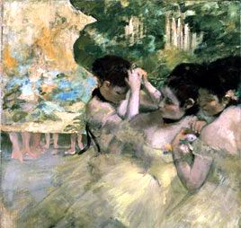

# 和我跳华尔兹,好吗?

昨晚往母亲的房间探头一看，被电视上的画面吸引住了。  
  
电视剧中一个外国女人和一个外国男人在一家氛围温馨的餐馆里跳华尔兹，双方主动的用眼神交流，面带微笑，女人自然展示着女性柔美的气质，那样的画面简直让我陶醉死了。那个跳舞的男人让他怀抱里女人随着舞曲转啊，转啊，转到那个女人眩晕，想要呕吐...然后男人扶着女人走到花园里，小心体贴地呵护着。啊！若让我眩晕到呕吐，只要能和自己的爱人跳那么一支优雅的华尔兹，也愿意呢！  
  
—[十二星座适合的舞步](http://zbinfo.net/20020311/216466.shtml)
