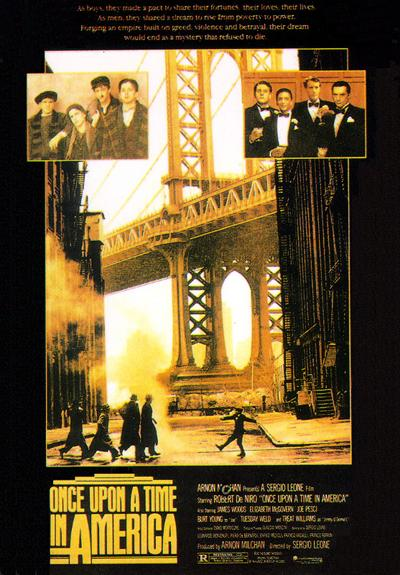

# 一个男人的电影《美国往事》

每个人的一生，不论是平淡还是不凡，灵魂是平等的。每个人总会有几个自己喜欢的东西，一段回忆，几本书，几部电影。我不知道还会不会有《美国往事》这样的电影让我感动。因为有的电影让你感动，不是它让你发现了什么，而是让你回忆了什么。在这个世界，你已经不需要寻找，你只需要去选择。  
  
我想也许艺术是分为两类的，一类是肉体的，给人以肉体的宣泄，一类是灵魂的，给人以灵魂的安慰。我想《美国往事》是后者。  
  
**如同真正永恒的感情一样，第一次的接触总是不经意和无意的，但又是难忘的。**  
  
在我即将要上大学的夏天，在一个教音乐的老师的家里，在客套的寒暄和问候之余，在主人有意的遮掩的缝隙，我看到了一些片段，多年之后，当我回忆起这段画面时，知道是“鲁德尔斯刚出狱，麦克斯在车上准备了妓女来迎接他”这一场戏。而在当时留在我印象里的是德尼罗忧郁的眼神和女人的裸体。  
  
而我最感动的就是鲁德尔斯少年的时光，因为那里面有太多我熟悉的东西。  
  
在老师和家长眼里，我是一个标准的坏孩子，和街区的几个同龄的孩子整日混在一起，逃学，和另一个街区的孩子打架，到不让游泳的地方游泳，偷别人家院里葡萄，坏孩子应该做的事我都做过了。可那却是我一生中最快乐的时光，那时候的天空永远是兰色的。大海也是那样的干净。我整日的在接上玩着。在街上，我慢慢懂得了友谊，尊严和勇敢。也许全世界坏孩子的经历都是一样的。像鲁德尔斯一样，在我的街区也有一个性感的女孩子，而且早熟。在家里没人的时候，我把她带到家里，脱掉她的衣服，抚摩她的全身，我冲动起来，可是又什么都不会做。那是我第一次性体验。我没有鲁德尔斯那么潇洒。什么都没有做。 　　  
  
如果我没有考上2中，这所当时青岛最好的初中，我的人生不会是现在这个样子，和我一起长大，在同一个小学的一个伙伴，现在已经是黑社会的堂主。我还记得我们一起在他家的阁楼上抄作业的情景。我们一起打架，一起追各个学校的校花。后来我考上大学，他入了黑道。有的人是很难选择自己的道路的，生活推着你向前走，你也不知道会走向何方。在看往事的时候，我经常会眼睛湿润，因为我也想起了这些和我一起长大的伙伴。  
  
在小学，我是一个漫不经心的学生，成绩时好是坏，努力一点，就会考出好成绩。老师也是又爱又恨。谁也没有想到，我以最后一名的成绩考上了2中。我现现在才知道这是我一生中的分水岭，因为它让我孤独，在这个学校里我是个另类，周围全是各种官宦人家的子弟。言谈举止里都透着优越。而原来街上的伙伴也各自上了一些以乱出名的学校，各自打出了名堂，有了自己的小帮派。在我家的街道上，我又成了一个难得的好孩子，别的家长都在告戒自己的不可救药的孩子不要把我带坏了，在街上我又孤独了。 　　  
  
多年之后，我才知道我有多幸福，因为我的教室是一间看的见海的房间。在课堂里，我是孤独而沉默的，成绩不好，没有特长，只会画点漫画。衣着寒酸。每天放学后，我都会靠在窗前看着渐渐变黑的大海，那里有一个瘦弱少年对未来的模糊的梦想。  
  
而后我会沿着海边走回家，我现在还能复述出我路过的每一个路口，一路上有很多解放前的外国建筑，只有和今天四处兴建的花园洋房相比，你才会知道它们有多美。我每次都会在一个院前停留，这是一个被改成青岛科技馆的德式建筑，在院门前有一个牌子，上面写着当天放映的内部电影的名字。《教父》《毕业生》这些我现在耳熟能详的片子，对于当年一个电车售票员的儿子来说，是陌生的，也是可望也不可及的。  
  
每一次看见一些衣冠楚楚，满脸严肃的人群从院里走出来，我都会在猜这个电影讲的是一个什么故事。透过那个深深的院子，那个普通的放映厅的大门，在我的眼里是那么的神秘，因为那对我意味着另一个世界。  
  
在一个秋天的放学的路上，在暮色里，我看见牌子上写着：今日放映美国犯罪片《美国往事》。  
  
对于每一个男人来说，人生最重要的就是从男孩长成男人这一段时间。一个人童年和少年的经历会影响一个人的一生。年少时经历的坎坷会使一个人在将来的性格走向两个极端，或者是特别坚强，或者是特别软弱。  
  
我不知道我是坚强的还是软弱的。一段画面，一段音乐，都会让我流泪。有的时候这让我觉的自己不像一个坚强的男人。我也不知道自己在生死关头会不会镇定从容。但我知道我要去做什么，我要得到什么，我要保护我爱的人。**有时候坚强的人会像狗一样的生活，但最终会赢得自己的尊严。**  
  
在《美国往事》中，我们没有看到鲁德尔斯是怎样长成一个男人的，只有他在囚车里伤感的和麦克斯，柯克埃，戴伯拉告别。告别了莽撞，冲动的少年时代。也许从监狱里出来的人也是分为两类的，一类是彻底的弃恶从善，另一类则是学会了犯罪。  
  
监狱让鲁德尔斯成熟了，重新回到伙伴中的鲁得尔斯已不再莽撞，冲动，他不像麦克斯充满了野心和疯狂，也不像柯克埃和戴伯拉那样盲从。他独立，冷静，没有太多的野心，也不喜欢多余的血腥和暴力。但他已经没有权利来选择生活，他被动的参与各种犯罪，除了生存之外，也是对友情的执着。这也注定了他生活的失败和漂泊的一生。  
  
其实我们大多数人又何尝不是在被动的生活，随着年龄的增长，我们离心中的梦越来越远。我们无奈而机械的在生活中扮演着各种角色。羡慕着成功者，也同情着失败者。可是却不敢问问自己，你的将来又会怎么样？  
  
成功和失败是无法界定的，有的人在过程中是成功的，结局失败了，有的人在过程中是失败的，但结局是成功的。可是你坚持到最后的时候，你会发现你拥有的只是痛苦的回忆和疲惫。  
  
当他们中最小的伙伴被子弹打倒，倒在鲁得尔斯怀里，对他说“鲁得尔斯，我滑倒了”。一个短暂的人生结束了。所有的梦想也结束了。**我们每个人也许都有滑倒的时候，不知道在那个时刻身边会不会也有一双扶着你的双手。**  
  
如果让你在一生的友谊和一段浪漫的爱情之间选择，你会选择什么？**我们往往得不到自己最爱的人，生活总会制造出各种各样的误会，摩擦来让你失去你最珍爱的东西。**鲁德尔斯最终没有得到自己最爱的黛博拉，孤独的走完了自己的大半生。**也许当我们已经不能拥有的时候，唯一能做的就是不要忘记。**  
  
我永远也忘不了德尼罗的眼睛，那双透过砖墙缝隙的忧郁，伤感的眼睛。总是在夜深人静的时候，藏在灵魂深处的那份最美好的回忆才会慢慢的浮起。我不知道在我步履蹒跚的时候会不会拥有鲁德尔斯这样刻骨铭心的回忆。  
  
黛博拉那翩翩起舞的身影，是影片中最美的画面。她那乌黑的长发，洁白的舞裙是那样吸引着少年的鲁德尔斯，也吸引着我们每一个人。  
  
在我的记忆深处，也有一个少年时的美丽身影。她没有动人的舞姿，只有静静的背影，让坐在教室后面的我不停的凝视。  
  
她是我的小学同学的表妹，在我考上初中报到的第一天，在操场上，她向我们走来，那是我见过的最美的女孩子，阳光下乌黑的长发，洁白的连衣裙，还有一双奥黛丽-赫本一样纯真的眼睛。她的美让我不敢直视。我只是希望她能和我在一个班里。  
  
我如愿了。  
  
每个人在自己的一生中都会有一段灰色时期。或早或晚，我时常问自己，如何就是灰色的，也许就是不能做喜欢的事情，得不到喜欢的东西。  
  
我的灰色时期是初中时期，这个时期也是我最自卑的时期，一个完全不能左右自己生活的少年。一个试图上进却总是徒劳无功的少年。一个渴望情感却最终孤独的少年。  
  
在这三年的生活中，我就像一个囚犯，每天走进学校，再走出学校。在各种课本面前，我是那样的无能为力。唯一的安慰就是，既然做不了最好，那就做最差吧。同样都是引人注目的。  
  
我坐在最后一排，身边永远都是班里成绩最好的女生。在我生活中的异性，总是不能才貌两全。就像我的同桌。她也一样，她的成绩也不是很好，所以她在第一排，身边是学习好的男生。  
  
我整日的注视她的背影，注视着她白皙的脖颈，注视着我能看到的她的一切。那是我灰色年代的一束划过乌云的阳光。安慰着我枯燥的生活。如同鲁德尔斯在监狱里思念着黛博拉。她占据着我全部的生活。  
  
慢慢的我也了解了她，我不知道她生父的情况，只知道她的妈妈带着她嫁给了当时的市府的一个高官，后来又有了一个妹妹。看的出，她是不快乐的。  
  
她总是安静的坐着，或者是听旁边的人说话，开心了就笑一笑，然后又安静的坐着。  
  
我从来没有和她聊过天，或是简短的说几句话。有人说，男孩子对于自己最喜欢的女孩子，往往是欺负最厉害的。可我怎么会欺负她呢？  
  
那时的我是自卑的，穿妈妈改过的旧衣服，每星期去一次公共浴池洗澡。手指甲里永远是黑黑的，是一个脏孩子。一个内心敏感的脏孩子。  
  
我总是试图逗她开心，引起她的注意。课堂上，我会画老师的漫画，故意传到她身边的同学手里，然后再传到她那。如果我看到她耸动的肩膀，看到她轻轻的笑，那就会是我最幸福的一天。 　　  
  
也许直到今天，她也不知道我曾经这样的喜欢过她，也许在她印象中，我只是一个瘦弱，沉默，喜欢画漫画的男孩。  
  
我永远忘不了她身上的气息，每一次我与她擦肩而过的时候，我都会闻到她身上那股清新的少女气息，是那样的让我沉醉。也封存在我的记忆深处。  
  
当我长大，当我已经习惯别人用帅来形容我，当也有女人为我着迷，为我哭泣的时候，我却再也找不到这样的气息。  
  
我是矛盾的，性感与清纯，总是左右着我的目光和灵魂。像鲁德尔斯一样，他可以像一个无赖一样去调戏放荡的佩姬，但是当他坐在黛博拉身边，听着黛博拉轻轻的为他念诗的时候，他是那么的局促，紧张。我们何尝不是这样，在灵与肉之间挣扎，在诱惑和冲动之后后悔。 　　  
  
也许得不到的永远是最好的，也许少年时的梦会影响人的一生，每一次，我面临选择的时候，我总会想起那个灿烂的如赫本一样的笑容，还有那股清新的少女气息。它们让我选择了继续孤独。继续寻找。  
  
有一个关于寻找爱情的故事，一个人穿过草原，只能摘一朵他认为最美的花。  
  
有的人没走都远，就摘了一朵他认为最美的花，然后又发现了更美的，在遗憾中走完了旅程。有的人先观察，不急于选择，等到走到草原中央的时候，选择一朵相对最美的花，心满意足的走完全程。有的人永远认为最美的花在后面，他一路寻找。抉择，放弃，再寻找，在寻找中，在孤独中走完全程。  
  
梦想如果成为现实，就不在是梦想了。  
  
多年之后，当我大学毕业回到青岛的时候，昔日的孩子都已长大，都有了各自的职业。当同学聚会的时候。她没有来。  
  
我知道了她的消息，她的继父后来又去世了，母亲又没有工作，家境衰落。她继父的一位朋友一直照顾她的家庭，后来，她嫁给了他。  
  
听到这个消息，我举起的酒杯停住了，我不需要再问了，她嫁给一个比她大几十岁的人。也许是感恩，也许是倚赖。这就是生活，现实的生活。不是电影也不是小说。  
  
我知道她总会长大的，会为人妻，为人母。我从来没有想到要去得到她。我只是希望她能够快乐的生活。同学很随便的说，她从来不参加同学的聚会。  
  
我知道，她并不快乐。  
  
那天，我喝醉了，我大声的笑，说着彼此的少年趣事。但我的心里却全是她的身影，那个穿过校园的一身白裙的身影，那个迎面走来的灿烂的赫本的笑容。  
  
我的心是酸的。  
  
我们再也没有见过面。  
  
**有人说，生活像一瓣洋葱，你一片片的剥开，总会有一片让你流泪。**  
**也许佛是对的，痛苦是永恒的，快乐是短暂的。**  
Where to?  
Anyway. First bus.  
Baffulo(水牛城)。  
One way.  
这是鲁得尔斯离开纽约时，在车站的最后一段话。  
至少我是幸运的，知道自己要去那里。

---

## 评论（1）

**[samba](http://www.salsa-nanjing.com)** · 2008-09-27

现在改了：痛哭是暂时的，快乐是永恒的。

