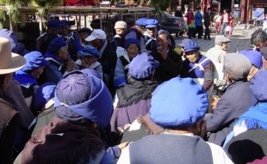
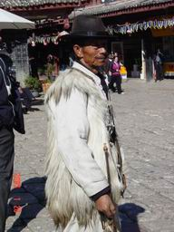
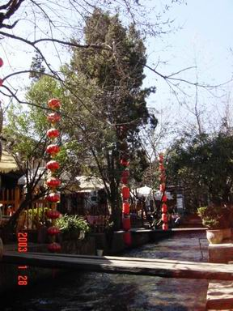

# 在丽江＂东巴　ＨＯＵＳＥ＂上网

嗨！到达丽江了。  
  
昨晚在MCA购买到丽江的车票，45元，9：40出发，今天汽车进了MCA的院子来接客人。不得不说MCA的服务有多么人性化。车程3个多小时，天气一直晴朗着，天蓝得让人想哭，那种纯净的蓝色，在南京根本看不见，很想夸张的说这里有全中国**最明媚**的阳光。就好象你面对一个人，他/她的性格开朗直爽，容易接近和沟通，那么我们也可以说这个人的性格是明媚的，你拒绝他/她吗？我想我爱上了这里的蓝天和阳光。  
  
从汽车站下车之后，乘出租车到丽江古城，只要是城内不管去哪里，一律6元车费。晚上12点之后或者出城，费用则根据计价器收费。进了古城，打好朋友GRACE的电话，她丈夫是纳西族人，父母家就在丽江，她丈夫的好友开了一间四合院的客栈，我打算住那儿。一直拨电话都没有人接听。四方街上，青石路边不几步就有客栈。后来我还是选择住在“茶马客栈”，80元/天，带独立的卫生间。一进“茶马客栈”看见四五个亚洲和西方的年轻人在院子里晒太阳聊天，客栈是个四合院，比起MCA的庭院当然是差了许多环境的情调。  
  
放下行李，闲步到四方街，一群纳西族的老年男女聚集在四方街的广场一角，吟唱于我不知所云枯燥的调子，问周围的当地人才明白他们在排练春节要在四方街上表演的节目。  
  
  
广场上还有三五个批着动物皮毛的汉子，背猎枪骑滇马，这些汉子被称为“马班”（意思是赶马的人）。我花三元钱用他们的毛皮背心、滇马伪装之后拍了PP。古城的街道全部铺着青石板块，建议来旅游的人穿耐磨底硬些的鞋子。  
  
  
**水**：水是古城的血液。水从黑龙潭流出。在城内形成东河、西河、中河。又再分化出无数条小溪，在各家门前淌过。  
  
  
**四方街**：古城的心脏。大约有400平方米，是“赶街”的地方，现代的“超市”。丽江古城最早叫“衣古芝”，衣古是地名，芝是集市的意思。现在丽江乡下农村人称古城为“古奔”，意思是“背着货物来做生意的地方”；古城居民为“古奔若”，若是人的意思。  
  
—四方街上的纳西老阿婆  
  
**七星羊皮披肩**：纳西族妇女常常穿蓝色服装并在背上披一块特殊的养皮披肩，披肩上有七个圆形点饰物，这块披肩被称为七星羊皮披肩。  
  
  
这块特殊的披肩是一块黑色羊皮制成的。羊皮上的七个圆形刺绣代表星星，披肩主要由黑白两色组成，白色代表天，黑色代表地。据说将天、地及星辰缝在她们的服装上象征着纳西族妇女每天早出晚归地辛勤劳动的情形。纳西族曾经是母系社会。知道这个历史，再通过一些观察，便会发现，纳西族妇女特别能吃苦耐劳。事实上，在乡村很少看得到纳西族男人肩负背篓或者重物的现象。这里只有纳西族妇女才会做这类的重活。诚然，这种习俗在年轻一代中间正在逐渐消失。
