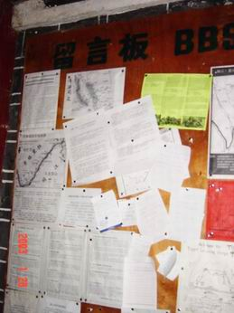
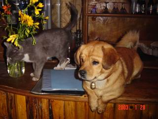
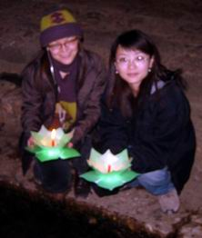

# 在丽江的第二夜

昨晚我到青年国际旅馆找在四方街认识的一对上海男女，青年旅馆院子入口处有个BBS板，上面贴满了各种寻游伴的纸条，搞笑的是入口处一条标语，写着：西装革履者禁止入内。  
  
  
在院子的小酒吧里等人的片刻功夫，看见吧台上一只猫和一只矮小敦实的狗和睦相处，  
  
一条大耳猎犬，一条斑点狗，一条黑色体型和斑点差不多的猎狗在酒吧的青年男女间来回游荡撒娇，让人分不清那些人中谁是主人谁是客人。还遇上MCA HOUSE认识的小日本,一个蛮和善帅气的男人哦。与几个哈日哈韩打扮的中国小男人及不知国籍的男人们正在院子里讨论今天徒步虎跳峡的事情。小日本要我和他们一起去虎跳峡，那3个中国人说他们男人去都要吐血，要是他们带个女的，3天的时间计划要拖延到4天。小日本看着我尴尬地笑，我也只好尴尬地笑。  
  
还好，和上海的木木（女）、王（男）约好包了辆车前往玉龙雪山、牦牛坪一代游玩，用了整整一天的时间。他俩是在飞机上认识之后，一起下榻在丽江的青年国际旅馆，和我在茶马客栈的住宿费用一样，80元/一个标间，亏的是我一个住，他们两个人住，我是不是也要找个人分担一下每天住宿的费用呢？那个木木是个可爱的小精灵，和几个人和开了一间服装设计公司，据说经营情况不错。  
  
这几天，宣科老东巴不在丽江，所以晚上去看了东巴歌舞和纳西古乐，这个表演团里有老有少，虽听不懂纳西语言，可是老东巴一板一眼的架势和神情也能感染观众几分。主持人翻译老东巴的几句话，特别送给茶的朋友，希望我们都能轻松看待人生的阴晴圆缺，如下：  
  
十三的月亮虽然不美，可是再过几天就要圆了  
十五的月亮虽圆，但是它就要缺了  
我们的人生就象这月圆月缺  
  
木木现在正在电话联系青年旅馆BBS板，纸条上明天计划前往泸沽湖的几个人，好象一共6个人，一辆中巴，加上木木和我正好。泸沽湖之后，计划去虎跳峡。下面几天我不会有电脑上网了，暂别你们几日。不知道泸沽湖是否有洗澡的地方？  
  
预祝茶上的朋友们新年不要为感情的事伤神，祝大家新年首先是健康，其次快乐，珍惜自己现在拥有的生活和感情。工作顺利，合家欢乐...虽然俗套了点，仔细想想还是很需要唠叨的！  
  
—和木木在丽江古城的水里放了两盏名为”希望”的花灯,看着它们顺流而下,飘向远方！我的愿望也是“希望”二字。
