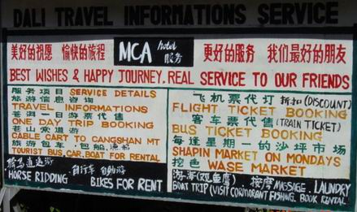
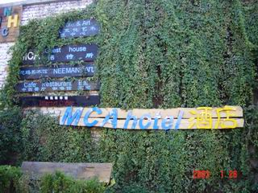
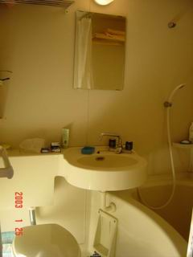
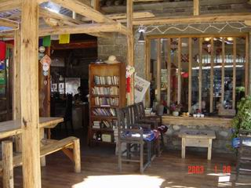
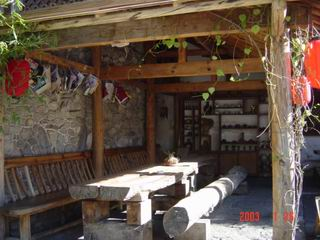
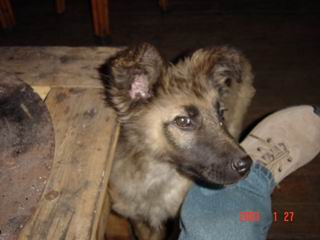

# MCA HOTEL

[**MCA HOTEL**](http://www.sunseries.com/ban/taiyangbu/sun001.html)是“全球旅行者”包括“中国旅行者”《指南》的酒店。酒店位于大理古城南门150米处文献路段，其庭院风格、自然、人文艺术的特点，是我们生活的温馨家园。  
  
MCA HOTEL有各种特殊规格的房间，从RMB30元/间至RMB100-300元/间不等，还有为自助旅行者、学生提供的RMB10元/床位。  
\*swimming pool & beautiful garden  
\*24 hour hot shower  
\*free internet  
\*library  
\*satellite TV  
\*art studio,cafe,bar…  
  
Tel:+86(0)872 2673666  
Fax:+86())872 2671999  
E-mail:mcahouse@hotmail.com  
Add:云南古城大理古城文献路距南门150米 MCA HOTEL  
post code:671003  
  
  
—MCA提供的服务  
  
  
—MCA HOTEL的标牌  
  
   
—MCA庭院  
  
  
—这是个连体的卫生间，除了隔音效果不好之外，其它功能都很健全  
  
  
—这里是MCA聚会、喝酒、看书、上网、聊天、用餐的地方  
  
  
—MCA休闲处  
  
  
—这只狗狗是MCA的，很丑可是很酷哦！独立性强。我吹个口哨它就过来了，喜欢咬我的裤腿，和我玩得挺好，晚上用餐前，它躺在火塘边让我给它挠痒，小子，不要太舒服了！
