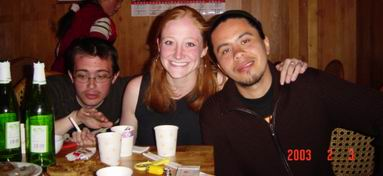

# 初三，在丽江的最后一天

初三是我在丽江的最后一天,上午10点多钟在古城里闲逛,来往的游客似乎没有前两天那么多.一家音像店播放的曲子吸引我走过去。丽江的CD（应该是盗版的吧？！）价格在15元/PC，另一种店里刻录的CD，黑白复印的封套，一张竟然是20元。坐在沙发上试听自己感兴趣的碟子，看见三个年轻男孩从店门前走过，其中的一个男孩在阳光下随着音乐翩翩起舞，我笑起来。几分钟后他们走进店里，朝我微笑，于是我们认识了。  
  
在云南旅行的途中，我目睹也亲身体会了两个陌生人相识的场景。  
1）一个美国人上了汽车，看见车厢内唯一一位和他一样金发碧眼的外国人，走到他身边的座位，边放行李边用英文说：“小孩子总是哭，哦...”于是那个外国人用英文接话说了起来，他们认识了；  
  
2）“嗨，能帮我拍张照片吗？”一个戴眼镜的男人问道。“哦，当然可以。”由这个上海男人“王”我很幸运地认识了后来几天和我同吃同住的木木。一天之后，我和木木甩掉“王”去了泸沽湖。谁让他是上海男人呢？腻死了！  
  
3）“吃口香糖吗？”“哦，好的。”两个座位靠在一起的陌生人交谈起来。  
  
4）微笑！什么话都不说，仅是朝着你想认识的陌生人微笑。这种方式外国人使用的比较多。  
  
最可笑而唐突地搭讪是走上前去，问道：“可以认识你吗？”愚蠢的搭讪，是吗？  
  
三个年轻人来自法国，一个是阿拉伯人和法国人的混血儿，一个是越南人和法国人的混血儿，一个是法国人。均是24、25岁，我那么大的时候哪有钱到这么远的地方旅游？我这么自尊的人也不好意思使父母的钱。  
  
晚上他们邀请我一起用餐，一起还有两个22、23岁的美国女孩和另一个30岁左右的法国人。其中一个美国女孩叫HONG（取自HONG KONG里的“HONG”），第一次来中国大陆，去年大学毕业。HONG自己出机票钱，她的朋友李云负担她在云南的费用。李云在西安一所大学任外教，她告诉我她的中国学生问她：“我怎么和我的异性朋友做爱？”CRAZY！真不知道这些中国的大学生问外国人这个问题是出于什么心理？李云回答他们：“我不是一个SEX老师，我是英语老师。”在我看来，现在的大学生比我们这个年龄段的人要观念开放，获取各种知识的途径远比我们那时侯要方便和快捷。他们在两性关系上也越来越不受道德约束。他们很知道怎么在多种关系中寻找平衡点，并自我感觉良好！  
  
—[ ‘a:tist ]，Hong，[ ‘bili ]  
  
那晚我们喝了不少啤酒，陌生人到相识，然后彼此告别。第二天各赴各的目的地。简单的生活，简单的人际关系，挺好！  
  
有人说我是个不断需要新鲜事物的女人。我对这种说法没有异议。**一个人避免麻木而去在意自己生活的状态，哪怕是无病呻吟！要我永远停留在80年代90年代，我不干。每个时代都有每个时代值得激动的地方。我们这个时代需要更多的敏锐，或者说需要更强烈的捕捉欲望，才能感受到这个时代带给我们的激情点。**

---

## 评论（1）

**[SARA](http://www.asiaccc.com)** · 2007-08-07

你好,无意中看到你这篇文章,因为我从事的工作就是有关丽江的纳西文化,我们公司自己制作了一部叫的专题纪录片,这是我们的网站,如果有兴趣可以上去关注一下,www.asiaccc.com。谢谢！

