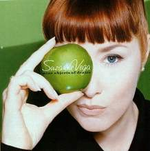

# 聆听Suzanne Vega

He is not my friend,but he is with me  
Like a shadow is with a foot that falls…....  
  
  
在丽江古城买了刻录的CD [《**The Best of Suzanne Vega**》](http://www.chinamp3.com/news/album/disc_html/disc988.php)。Suzanne Vega自小入纽约表演艺术学校学舞蹈。年龄稍长，她喜欢读西尔维亚·普拉斯的内向的诗歌，听可罕和迪伦民谣时期的歌曲，并开始在纽约一些俱乐部演唱自己写的歌。随着维加与唱片公司签约，她很快树立起“80年代琼尼·米切尔”的形象。 维加最诱人的是那些描写现代都市女性的歌，操一把原声吉他，穿一件破旧皮上装，冷漠清静的表情透出内心的感情压抑、矛盾和空虚。   
  
“别让冷漠的声音和无知的眼神愚弄你”, Jeremy Hellger 在为 New York Review 写 [**Suzanne Vega**](http://www.rockself.net/musicians/Suzanne-Vega.htm) 的专辑 “99.9 F” 评论时如是说道，“Suzanne Vega 是一个机极富包容性的歌手，词曲作家。” Suzanne Vega 被认为是80年代民谣运动复兴的领军人物,那时她经常环抱着木吉它出没于 Greenwich 村的俱乐部，唱着那经由她自己改编的黑人布鲁斯歌曲及现代民谣歌曲。  
  
这是张没有封套没有歌词的CD光盘，并不全明白她歌中所唱的是什么，那种轻声在她的歌里有一种很女性化的感觉，很细腻，很敏锐，也许还很琐碎，但也正是这种细腻而琐碎的东西串起了我们对生活的感觉。有人说：“在歌手里面，她显然低调而过时。象一张发黄的皱巴巴的纸。被信手撕下。一贯的慢不经心的抑郁腔调，和神经质的木吉它。她看过去自私而美丽......”  
  
希望你喜欢我买的碟~~  
  
I can feel his eyes when I do not expect him
