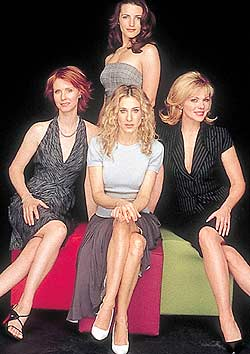

# LIFE IS A SERIES OF HELLOES AND GOODBYES

昨晚看了[《**SEX AND THE CITY**》](http://eladies.sina.com.cn/2002-11-21/61710.html) 前两部的六集，从晚上7点一直看到9点半左右，全看完了，后面的三、四部当时店里没有，也不知道什么时候会有的卖，对白挺精彩的，“......你象男人一样去寻欢吗？你爱过吗？你的道德是否也向意大利一样正在下沉？你周围的男人们是否不愿承诺只要做爱？你知道什么是曼哈顿式的结束吗？.......”  
  
专栏作家**凯莉**思想活跃，深刻尖锐，敏感善良是理性和感性的结合体。她能清晰地看到自己和他人的缺点，但总是掉进各种麻烦的感情里。她一度和比格交往，可拒绝和她结婚的比格却邂逅了模特娜塔莎并闪电结婚。凯莉大受打击，她理性的一面接受了深爱她的亚当，而感性的一面却笃信“得不到的才是最好的”。所以，当比格厌倦了新欢重新回头时，她感性的一面与其发生了关系，而理性的一面却笃信“诚实是最明智的”，并向亚当承认。结果就是，她泪水满面地目送亚当和他破碎的心渐行渐远……   
  
“離情依依”凱莉經典名句  
凱莉：當晚我靜下來好好思考宿命.不過是我們為逃避現實而編出的藉口.卻都在意料中.寫在星空下.這或許可以解釋.如果你住在一個連星星都望不見的城市裡.你的感情生活總是隨緣.即使我們的每位男人.每個親吻.每次心痛.都是量身訂作.我們是否仍會因走錯一步而與緣分擦肩而過？我禁不住想：我們是否會因為失誤而與錯過真愛？  
  
Later that night,I’ve got to thinking about fate,the crazy concept that we are not really responsible for the courses our real life takes,But it’s all predictive,reading in the stars,maybe that explains why,if you live in the city,where you can’t even see the stars,your love life tends to feel a little more random,and even if our every man,every kiss,every heartache,is pre-order from some cosmic catalog,can we still take a wrong step and wonder off our personal milkyway?I couldn’t help but wonder,can you make a mistake and miss your fate?  
  
律师**玛兰达**坚强独立，对工作有自信却惧怕爱情，不能完全释放自己。她渴望有人陪伴，于是请求男友斯蒂夫与她同居。可当她发现同居意味着没有距离和空间的减小时，又突然害怕那种亲密的感觉。于是，斯蒂夫被无情地轰了出去……   
  
**夏洛特**敏感浪漫，是完全的理想主义者，百分百相信爱情和婚姻。因此她３０多岁了依然坚信灰姑娘和白马王子的故事会发生在自己身上，并期待从此过上幸福快乐的生活。于是，当英俊富有，体贴的特瑞出现时，她牢牢地抓住了这个梦。但现实永远是残酷的，特瑞不为人知的生理缺陷使二人的关系陷入困境，婚姻至上的夏洛特突然发现自己成了出轨的那一个……   
  
公关经理**萨曼莎**对任何事都充满自信或过度自信，从不掩饰自己的欲望和放荡不羁。她有目标就去追求，本能地展示自己的魅力，并能轻易地和偶遇的男士发生一夜情，却也永远能分清欲望和爱情。萨曼莎享受着她的单身生活，周旋在各式各样的男人中间乐此不疲……   
  
《欲望城市》的幽默和独特观点主要都通过剧中人物的对白来表现。从下面节选的一些经典台词中，可见一斑。  
  
凯莉：我不得不承认，比格让我伤痕累累。我们就像住在高楼上的骄傲女人，被自己的激情灼伤了，害怕重新开始。   
  
萨曼莎：你做完眼睛手术可以让史蒂夫来帮你。   
  
玛兰达：为什么叫他？我不需要男人的帮助，我一个人能应付。再说了，我们只是普通朋友。   
  
萨曼莎：得了。咱们俩是朋友，怎么我不跟你上床？只有女人才是拿来交朋友的，男女之间没有友谊。   
  
凯莉：我们究竟打算怎么办？难道到了８０岁的时候，我们还能像现在这样成天游荡在酒吧，呷着“四海为家”（一种鸡尾酒），然后和陌生人上床？   
  
凯莉：比尔要竞选市长，而不是竞选总统。   
  
萨曼莎：为什么不？他长得那么可爱！   
  
凯莉：这有什么关系？   
  
萨曼莎：当然有。我投票选总统时，都只选长相英俊的那个！  
  
看《欲望城市》是一种享受，因为除了幽默的对白和经典剧情，还可以看到曼哈顿最流行服装款式和上流社会的聚会。凯莉们用尽信用卡里的最后一分钱，掩藏着自己已过３０的年龄，和妙龄少女们争抢为数不多的单身好男人。
