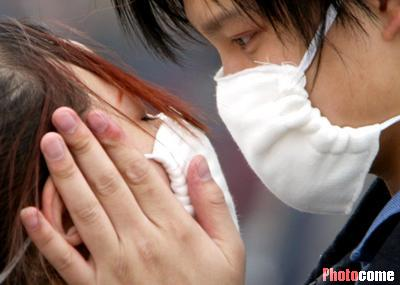

# SARS PIX

**SARS时期，我们最惦记着的就是自己爱着的人了，有些时候你以为你被某人惦记着，结果对方连句叮嘱的话都没有，那感觉跟得了SARS一样的难受。所以昨晚换了SHERRY提供的这些情侣照片，好让空气里多些温柔和真情！**  
This picture of the two young lovers is the symbol of love in the SARS times. People’s lives are affected; faces are covered by the masks; but the lover and the family are even closer with each other. Taken near the Beijing West Railway Station.   
  
daniel的留言，这里借用一下：   
我怎么觉得好象相反呢，以前我怕老妈唠叨，电话是能少打就少打，现在是每天最少一两个互报平安，gf被困在北京，我很想回去陪她一起度过这一段危险时间，她以前一个人住都害怕，现在却说死都不让我回去。还有很多平时好久都不联系的朋友都打电话来问候，短短几句话，可是让人感觉相比起来，非典也并不是那么可怕  
2003-04-26 @ 12:04:42  
  
早上收到[WangJianShuo](http://www.wangjianshuo.com/)的有关SARS的一些图片连接，如下：[SARS Pictures From Beijng and Shanghai](http://home.wangjianshuo.com/archives/20030424_sars_pictures_from_beijng_and_shanghai.htm)
