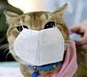

# 口罩生活

戴上口罩自己马上有了种特别的状态，所以眼神也不自觉地诡秘起来，呵呵~~~  
  
到了那些相对封闭的场所时，不想戴口罩，可是还是会犹豫。比如电梯，比如商场...不过当我看见那些骑着自行车戴着口罩飞驰而过的MM时，心想“臭美啥？搞的跟个真的似的。”说笑归说笑，上周GOGHS打电话说：“我怎么觉得大街上的南京MM都漂亮了？满大街美女啊~~~”是哦，想象无极限。估计SARS之后，MM们都不愿意摘下口罩见人了，某些新名词“见光死、恐龙”之类的也要绝迹了。  
  
早上赖在被窝里看书，读到这么一段话“假如你认为我是一个无聊的人，那么说明你还没明白什么是真正的无聊。问你一个问题：你觉得生活有意义吗？我告诉你我对这个问题的思考：生活本身是没有意义的，生活的意义需要我们去发现。我这么多年做的就是努力去发现生活对于一个普通人的意义—当你发现自己不可能成为爱因斯坦也不可能成为居里夫人之后，当你明白你一生也不可能抵达金字塔尖儿的时候，你要做什么才能使自己的生活“有意义”？对于普通人来说，一生的大部分时间就是要和“无聊”相处，相处得好叫“生活情趣”，相处得差叫“枯燥乏味”。我很早就知道无论我怎样写，也成不了列夫.托尔斯泰，但我还是要写，这叫“知其不可为而为之”，生活的快乐和悲伤都在这中间了。”  
  
那么，口罩为无聊的生活也带来了乐趣，不是吗？我们戴着口罩不仅是为了防止病毒传染，有一部分原因也是乐趣使然，呵呵~~~这里我收集了一些[戴口罩的PP](http://www.imagestation.com/album/?id=4290284091)。在我的HOTMAIL信箱里发现有人发了下面这些可爱的[戴口罩图形](http://ejokeimg.pchome.com.tw/see-post.html?Flow_No=3988&cat=3&Page=0)，经常使用MSN聊天的人一定不会陌生，是吗？  
  
  
  
—偶也臭美一下。戴口罩其实挺受罪的,很热很闷。偶戴了一会儿还是忍不住摘下来，不想自己折磨自己。而且我们公司发的口罩特别大,能把整个儿下巴包得严严实实。**看我和旁边的猫咪还象啊？**  
  
上周五的《现代快报》A3版报道：北京广东大批人员涌入南京......经统计，4月22日晚南京开往北京的T66仅808人，该车2天后返回南京，共载有1300余人，而该车核定旅客为1058人，超员20%多。南京直达广州的1311次列车，去时1931人，4月23日返宁时车上旅客高达2279人，该车核定旅客1180人，严重超员。从民航、公路反馈的情况看，民航进出客流相差1000多人。截止到昨天（4月24日）17时，机场运输部统计显示，南京飞北京的有411人，北京来宁的有533人；南京飞广州的有333人，广州来宁的有245人。公路客运开往北京和广州班次全在中央门汽车站，广州班已停开，去北京的客流相对稀少。  
  
—[《Love Will Keep Us Alive》MP3](http://www.dvxj.com/mp3/eagles-love.mp3) - The Eagles   
  
i was standing  
all alone against the world outside  
you were searching  
for a place to hide  
lost and lonely  
now you’ve given me the will to survive  
when we’re hungry…love will keep us alive  
don’t you worry  
sometimes you’ve just gotta let it ride  
the world is changing  
right before your eyes  
now i’ve found you  
there’s no more emptiness inside  
when we’re hungry…love will keep us alive  
i would die for you  
climb the highest mountain  
baby, there’s nothing i wouldn’t do  
now i’ve found you  
there’s no more emptiness inside  
when we’re hungry…love will keep us alive  
i would die for you  
climb the highest mountain  
baby, there’s nothing i wouldn’t do  
i was standing  
all alone against the world outside  
you were searching  
for a place to hide  
lost and lonely  
now you’ve given me the will to survive  
when we’re hungry…love will keep us alive  
when we’re hungry…love will keep us alive  
when we’re hungry…love will keep us alive  
the end.
