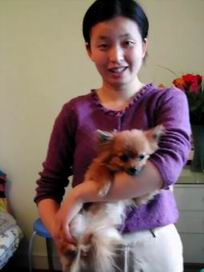
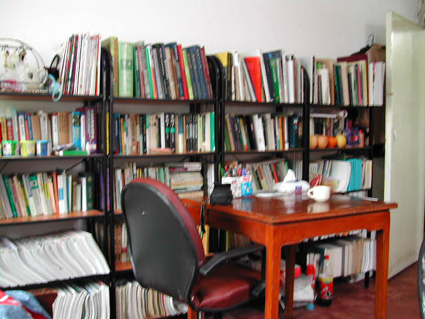

# GRACE的信

亲爱的S：  
  
这次回南京在百脑汇买了数码相机，就拍了些生活照寄给你，希望你喜欢。  
  
有狗狗的照片是在我妈家，最近闹SARS，宠物不能上街，它十分憋闷，看到我回家，兴奋得又叫又跳，缠着我玩，我索性坐在地上，和它玩个10多分钟。她越来越熟悉我，隔着门分辨得出我的动静，不再乱叫了。妈妈对它的要求很高，如：干净、不乱咬东西、不上沙发、只在报纸上大小便等等，我心想作一只狗也不容易啊。当凯丽达到了这些要求后，妈妈也渐渐接纳了它，产生了感情，甚至把它和我混起来。一次我、杨、妈去超市，出来时，妈招呼我：“凯丽，把油拿上。”又一次，我在其他房间，妈和杨在看电视，当然凯丽也在，放到动物世界时，出现老虎的镜头，凯丽一阵乱叫，妈妈训斥：“GRACE！不要叫！”凯丽居然真的停下了，疑惑地看看她，妈妈也反应过来，回过头不好意思地偷笑。  
  
另外的照片是在同济我和杨租的房子里拍的。有一面墙都是书，我的、杨的，连我妈以前的建筑杂志也有。刚从南京搬来、买书架理好，我常常非常满足地看着这面墙，虽然架上的书大多数没看过，我还是觉得自己很有成就感。我们的房子靠东头，有一面墙上有窗，因为用电脑怕眩光，杨用他从敦隍买的扎染桌布挂上，透过光出现特殊的效果。杨在书架前看书一张，当然是我拍的，杨夸我有进步，因为有背景的意识。  
  
还有一张是我自拍的，也是这台相机的处女作，因为显得我太胖，就处理了一下。  
  
  
  
  

