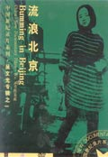

# 流浪北京

Bumming in Beijing：时长：150/70分钟；  
拍摄年份：1990年；导演：吴文光   
*From [**SunsetHouse**](http://blogbus.com/blogbus/blog) Posted by 新几内亚白人*

“片子记录的是五位自由艺术家80年代末在北京的一段生活。五位人物是：写作的张慈、拍照片的高波、画画的张大力和张夏平以及戏剧导演牟森。他们户口所在地分别是云南、四川、黑龙江等，他们放弃老家的工作来到北京、或者在北京大学毕业后自动留在北京，途径不一，但目的大致相似，即在北京实现自己的艺术梦想。”

一部好多年前的电影，去年（还是今年）才有正式出版的DVD。可惜，这可悲的正版，只能放映40多分钟，然后就死掉。预告片也无法观看。叫我怎么支持你，正版？！ （注：影片可能是betacam机拍摄，所以清晰度比不上预告片中那些用DV拍摄的后期作品，但已够播放级了，再说，声画效果对于纪录片来说也没有用武之地。）

据可看到的40多分钟来说，有很明显的那个年代的痕迹。梦想还比较天真，人人向往国外（片中的张慈说：美国是世界文化的中心……眼睛闪闪发亮。 结果嫁给了一个美国老头，去了美国）。

吴文光的DV，可贵在片中的人物都很自然，没有一丝做作的感觉。可能是他们相交已很深的缘故吧。

前不久看到一篇报道，是讲这个片中的各个人物的现况。好像都在国外了吧，过着不同的生活。自由，特别是心灵的自由，真的只有到国外才能得到么？

片中的高波，自由摄影师，哼着“我要离开，我要存在，我要死去之后从头再来……”。那一刻，强烈地感到了1989年的气息，扑面而来。

那一年，夏天很忧郁。 不是因为同学的远离，而是我开始初恋。   
那一年，夏天很ＸＸ。 “妈妈，我饿。 但是我吃不下。”

也是他，说，其实盲流，哪个人内心深处没有一点盲流呢。也是啊，所谓流浪，所谓行走，很多好像只存在于青春的梦里。但多年以后，内心深处，偶尔的，也会被轻轻触动。

生活，永远，在别处。   

