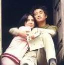
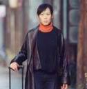

# 似水年华

昨天中午听一个办公室的同事提到[《**似水年华**》](http://www.cctv.com/teleplay/special/C10640/20030626/100842.shtml) 这部电视剧，很感兴趣，今天一个署名郑蕾的人留言：看了你的网站总是让我想起最近热播的似水年华。于是，搜索来细细研究，故事发生在世纪之交的江南古镇——乌镇。《似水年华》讲述的是一个6天的爱情故事，一个江南小镇的图书管理员，一个台湾时装设计师，因为偶然的一次注视，彼此成了**一生最永恒的思念**。这6天的爱情并不惊心动魄，但却刻骨铭心。古典秀丽的乌镇、似水缠绵的爱情、奇幻唯美的画面，《似水年华》将一种浓郁的人文气息深深吸收进来。

一个人的命运，也许就是他一生的种种选择，我们在这些选择之间成长。这是一个关于选择和成长的故事。人生的种种选择之中，情感又是特别让我们困扰的。这是一个关于情感的故事。

故事里有一些很特别的人，但他们决不另类。他们的生活理念和价值观与一般人没有什么不同；他们面对人生做的选择，跟大部分人也都差不多；他们遭遇到的生活的玩笑，其实每天都可以发生在我们身上。

只是在故事里面，面对情感的问题时，他们心无旁骛，目不斜视。他们为情感真实地困惑着，认真地抉择着。他们也因此而有了诗意的光彩。

故事的时间跨度是五十年。我们第一次见到我们的剧中人物文和英时，他们是三十岁，正是面对选择的年纪。他们相遇，爱，然后分离。当我们在剧终再见到他们，已是五十年后。这中间他们的大半生光阴，对于我们是空白，留给他们自己……   
  
......英失眠了，躺在床上辗转反侧；文见齐叔叔的房间灯灭了，便悄悄溜出了书院。凌晨时分，英和文在这个像睡着了一样的小镇上偶遇了。两个人只隔着两步之遥，他们聊天气，聊童年，英请文带她夜游乌镇。二人来到逢源双桥，英站在文的身后，隔着栏杆注视着文。英不知道该说些什么，也许这个时候，只有沉默才能代表一切。文在栏杆这边走来走去，英隔着栏杆也在走着。文突然转头隔着栏杆看着英，目光交汇在了一起。[更多剧情介绍](http://www.cctv.com/teleplay/special/C10640/20030626/100683.shtml)
