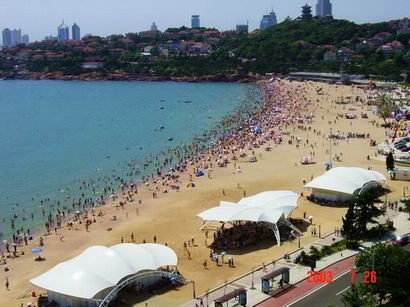
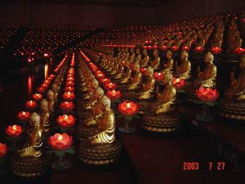

# 今天从青岛回到南京

一年一度的休假，2003年公司选择在[**山东青岛**](http://www.imagestation.com/album/?id=4289556779&p=4220327117&idx=1)，浩浩荡荡80人左右的旅行团25日一大早乘8点的飞机出发了。  
—从我居住的汇泉王朝酒店1563房间的阳台上拍摄的海滨第一浴场

在青岛时住在汇泉王朝酒店，临海，青岛海滨第一浴场就在酒店对面，免费开放，每天有很多人在海滩上游戏玩耍休闲。但比起海南亚龙湾和西岛海水及海滩上的沙子质量却要逊色许多。青岛马路整洁，几乎看不见骑自行车的人，临海地段城市规划是我去过中国城市中给我印象比较好的，每幢建筑间隔空间很是宽敞，大部分是单行车道，建筑周围绿化面积较大造型也不错，看得出是动过脑筋的。青岛最普通的房价达到3000/平米，临海地段少则10000/平米，那里也象北京一样控制人员户口迁入。出租车生意不好做，青岛公共汽车多几分钟就有一辆，人们更倾向乘坐公共汽车。青岛出租车起步价为四公里7元，之后每公里费用为1.2元，青岛出租汽车司机每月均收入在1500元左右。山东菜烹饪粗糙，似乎山东人不太讲究吃喝的问题，有人夸张地说青岛公共汽车上弥漫着一股大蒜的味道，呵呵~~总之，这四天没有吃到什么可口的饭菜，哦，对了，馒头还是不错的。

白天跟着旅行团看所谓的景点，实则空洞无味。之后除了睡觉，尚有些剩余时间用来享受幸福和快乐。和我同房的小女生在这些剩余时间里活跃的象只小鹿，有个晚上居然到凌晨4点多钟才回来，听见卫生间里水哗哗的声音，我醒了，接着她出去又回来，然后睡觉。早上叫醒服务是6：00，所以她几乎没怎么睡。后来她告诉我他们7、8个人在酒店的酒吧玩，然后一起出去吃夜宵，接着到海滩看海玩水......很佩服他们的熬夜功夫。

青岛的夜晚比较凉，海风吹拂在皮肤上湿漉漉的，沿着五四广场附近的海滨路在橘色的路灯下行走很惬意，顺便买了“五四广场和栈桥”的小纪念品。坐在临海的椅子上仰望广阔天空，那种感觉是一生一世的，因为时间在那一刻凝固。真羡慕青岛市民每年都能拥有那么美、那么凉爽的夏夜。

在青岛停留两天接着去了南山村，有点类似华西村的地方。28日返回南京的上午很仓促地游览了蓬莱仙境。去蓬莱之前必须先去观音阁膜拜，庙中央有座四面观音，听导游介绍了一下，什么都没记住。接着被领进一个方面说是什么修道很深的和尚可以为我们解说人生，那个和尚叫我过去，我单腿跪地装出很虔诚的摸样听他说到：“你这个人很重感情，心直口快。你能为你身边的男人代来财运和福运，前年你不是很顺，去年还行，今年要小心些，明年的7月会有事情发生你要当心。在现在的单位里你看得见很多财运可是抓不住，因为你身边有许多小人，你离开这里自己搞公司或者做生意，会更好。烧两柱高香....”哈，两柱高香260元，故事还没完，烧了香许了愿把香烛送给那个和尚，他又叽里咕噜说了很多话，结果我什么都没听清，他的语速太快。他要我去请一座金蟾回家，要老和尚开光之后才灵验。蟾蜍+开光共花去380元银子，呵呵，这还不算多的。听说有个同事要烧7柱香呢。这个烧香许愿的过程就是告诉我们心里有就有，心里没有就什么都没有。

—南山大佛景点内的几千尊佛像
