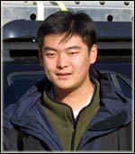

# 央视三套全新电视品牌《星期二唱片街》

刚才看了会儿中央电视台三套7月8日悄然开播的《星期二唱片街》节目，这期采访庾澄庆。哈林日前推出的新专辑[《哈林天堂》](http://ent.163.com/ent_2003/editor/030609/030609_172228.html) 中，主打歌[《春泥》](http://yule.sohu.com/26/00/article210440026.shtml) 是由老婆伊能静填词，他笑说：“其实之前她就在我的专辑中写过几首歌，但是都是用本名吴静怡，现在终于能用伊能静填词”，[歌中唱到](http://entdown.163.com/ent/0307/16/yu.ram)：

漫天的话语纷乱落在耳际 你我沉默不回应  
牵你的手 你却哭红了眼睛 路途漫长无止尽  
多想提起勇气 好好地呵护你 不让你受委屈 苦也愿意  
那些痛的记忆 落在春的泥土里 滋养了大地 开出下一个花季  
风中你的泪滴 滴滴落在回忆里 让我们取名叫做珍惜

迷雾散尽 一切终于变清晰 爱与痛都成回忆 遗忘过去  
繁花灿烂在天际 等待已有了结局  
我会提起勇气 好好地呵护你 不让你受委屈 苦也愿意  
... ...

这首歌的旋律很美,歌词也颇有咀嚼的味道！只是哈林的歌曲之后看见主持人[**管彤**](http://www.cctv.com/tvguide/anchors/0606_guantong/)，身着黄衫、浅蓝色牛仔裤，腿缝两侧白色条状的装饰，穿着凉鞋的那双脚丫好象还穿了豆沙色的丝袜。以前看她主持过《同一首歌》、《中国音乐电视》、《音乐电视城》以及《新视听》，我个人认为她的气质、谈吐主持综艺类电视节目很是牵强，形象清淡而柔弱，不够饱满和时尚。管彤的电视形象不知道是她自己设计的还是有专业人士帮她策划，一个人的穿衣品位也能代表这个人对生活的品位追求，主持人整体形象风格体现和代表了她所主持的节目的风格和方向，全中国找不到更好的主持人了吗？这是我第一次看《星期二唱片街》，搞笑的是节目还安排了几个女孩作为明星队成员给嘉宾的歌曲打分评论，听了其中一个女孩的发言，思维不紧密、组织语言的能力比较差，声音垮垮的，用南京话讲：不能急了！哈林坐在台上一个“啊”、两个“啊”的。整个节目里主持人矜持之外，观众也比较矜持，大家好象在上课，节目唯一的亮点只有嘉宾一个人！我知道如此描述我们国家名牌电视台的节目未免刻薄了些，但是，真的真的是不能急了。还有那个修饰的参次不齐的舞台，很担心歌手不小心会在上面摔个跟头，舞美也不咋的。《星期二唱片街》的节目内容应该还是很不错的，只是刚才提到的几处实在是大煞风景。

中央电视台我比较喜欢的电视节目有《艺术人生》、《走进非洲》、《对话》、[《小崔说事》](http://ent.sina.com.cn/2003-07-28/1650177724.html)、原来的《实话实说》、[《极地跨越》](http://www.cctv.com/geography/jidi/qfbd/)《东方时空》等等。其中很喜欢的主持人有：赵琳、蒋梅、田野、黄健翔、崔永元。特别喜欢《极地跨越》节目中的田野，他是我心目中理想的爱人形象！最近看他和一个女孩主持的《走进非洲》，有时我在想田野的女人是什么摸样的？他结婚了吗？和他一同主持节目的女孩会不会也喜欢田野？呵呵~~~喜欢一个人真的不需要理由。其实从小到大我就没追过什么星，更没有偶像，可在电视上见到田野的第一眼就有种亲切感！

田野 [《极地跨越》](http://www.chnpec.com/chnpec/2003show/program/jdky.html) 摄制组报告人   
男，1974年12月7日生。   
1997年毕业于北京外国语学院西班牙语系，担任中国国际广播电台记者和播音工作。   
2000年至2001年赴墨西哥公派留学。
