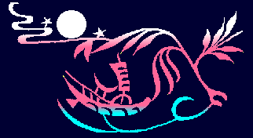
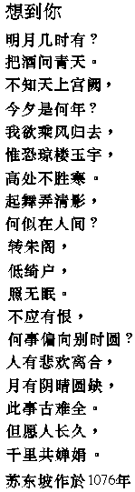

# Happy Mid-Autumn Festival

“Thinking of You”
When will the moon be clear and bright? With a cup of wine in my hand, I ask the blue sky I don’t know what season it would be In the heavens on this night I’d like to ride the wind to fly home Yet I fear the crystal and jade mansions are Much too high and cold for me Dancing with my moon-lit shadow It does not seem like the human world The moon rounds the red mansion Stoops to silk-pad doors Shines upon the sleepless Bearing no grudge Why does the moon tend to be full when people are apart? People may have sorrow or joy, be near or far apart The moon may be dim or bright, wax or wane This has been going on since the beginning of time May we all be blessed with longevity Though far apart, we are still able to share the beauty of the moon together. —Poem written during the night of the Mid-Autumn Festival of 1076Y?by Su Tung Po

