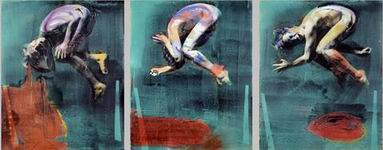

# 无题

中午看见新来的女同事坐在办公桌前上网，很多人去吃午饭了，一个PL MM在寂静的中午一个人呆在办公室里尤其显得孤单。想起有人说：“一个女人最痛苦的事情是什么？是让她穿上漂亮的衣服，然后把她关在一个封闭的房子里，那是最让她痛苦的事情。”当这个女孩意识到自己的漂亮，但是又没有人象自己那样去关注的话是很残酷的！自从PL MM来公司后，周围的男同胞突然都变得忙碌起来，我们这个办公室的打印机随之也忙碌起来......因为别的屋打印机坏了，只好用我们的打（每个办公室基本上有2台打印机）。  

OFFICE把很多人集中在一起，天天上演着精彩的话剧，剧情里有美丽也有丑陋，我们既是观众也是演员，所谓看戏的是傻子演戏的是疯子，所以我们是傻子和疯子的结合体。有时，我们就象图片中的人一样赤裸裸的，姿势夸张、表情张扬而内心如油彩般油腻斑斓。

有个犀利的家伙说：“嗨，你自甘堕落了？！玩世不恭了？！”与其这么说不如讲不再那么理想化。GRACE写信说她有许多自设的心理障碍，也想试着跨越，要我和她一起去试试看。其实自设心理障碍在某些方面未必是坏事，比如可以给自己的精神世界围个栅栏，好在里面种种喜欢的花草，把自家庭院搞的赏心悦目些。
