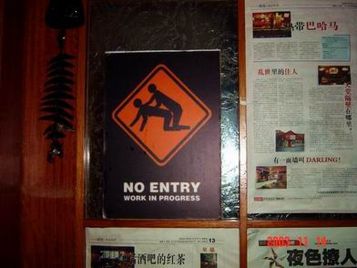

# 在天堂隔壁遇见猪头和水木年华

四个女孩中的老大去苏州给别人上课去了，总是有好心人提醒她第一次当老师是否会紧张颤抖的问题，于是老大把薄薄的纸张换成了沉重的文件夹拿在手中，准备带上讲台使用。对于我们三个人周末的活动她更是咬牙切齿了一番。

这个周末的[天堂隔壁](http://christina.tecinese.com/index.php?p=2016&c=1#comments)没有上周末人多，帅哥也少了大半，我们刚刚落座就有信差过来询问沙发上有人想与我们一起喝酒聊天，“他们是不是帅哥？年老的帅哥就算了。”信差答：“如果他们很有MONEY呢？”这答案真让人头晕，呵呵~~“我们比他们更有MONEY。”信差转身回话去了。这是什么世道？他们以为有钱就能泡妞了？？？鸽子说：“那两个男人真搓，跟猪头似的。”但凡猪头似的男人多半会先显示自己就要溢出银行帐户上的MONEY，然后描述一翻自己如何似景的前程，多半的猪头也会固执的认为钱是最有杀伤力的泡妞武器，这些猪头真是可怜的令人同情！

这个夜晚对于MAVIS最大的收获就是遇见了“水木年华”，他们和一群操着京腔穿着粗糙（那是个性）的北京男女坐在我们邻桌的位置，MAVIS马上要求他们为其签名，而我们这里还在云雾间行走，过去只听说过“水木年华”这个组合的名字，其中一个戴墨镜的家伙悄声问我：“你都听过我们哪些歌啊？”“啊~~~~~~对不起我一首都没听过，她刚毕业你去问问她吧。”为了不让对方受打击我指向MAVIS，MAVIS在相同问题下兴奋地在椅子上跳跃了一下：“哎呀，听过的太多了。”她在语气中特别强调了“太”这个字，“能说说什么歌名吗？”他们紧追不放。MAVIS楞了1/3秒：“我太激动一时想不起来了。”接下来的几秒中大家无语，MAVIS突然笑起来说：“什么XXXXX，对吗？”（我还是没记住歌名）而这个夜晚对于水木年华的最大收获就是遇见了MAVIS，在我们离开天堂隔壁之前只有MAVIS认出了他们、找他们签名，并说出了他们唱的一首歌名。之后，南京十八频道的主持人叶风也来了。

[**—MORE PIX**](http://www.imagestation.com/album/?id=4288586805)

  
**WC门口这么有创意的牌子怎么能不拍呢？**

  
**水木年华和天堂隔壁酒吧的老板**

今天在网上找“水木年华”的歌听，很想告诉他们：其实你们的歌很好听。昨晚我都觉得自己够残酷！这里将他们的《中学时代》更换为茶的背景音乐。晚上去铁心桥驾校练车，最后一堂夜训课，约了7点到9点的时间。

1、[**四月物语**](http://www2.whedu.net/scms/shuimu/siyue.mp3)  
2、[快乐园](http://www2.whedu.net/scms/shuimu/happy.mp3)  
3、[水](http://www2.whedu.net/scms/shuimu/water.mp3)  
4、[在他乡](http://211.70.144.5/~xxc1212/atotherhome.MP3)  
5、[**美丽人生**](http://www.syszedu.net/personal%20home/gongchao/mp3a/smnh/05mlrs.mp3)  
6、[今天我们要走了](http://www.syszedu.net/personal%20home/gongchao/mp3a/smnh/02jtwmyzl.mp3)  
7、[**中学时代**](http://www.syszedu.net/personal%20home/gongchao/mp3a/smnh/11zxsd.mp3)   
8、[蝴蝶花](http://sy.syszedu.net/gongchao/mp3a/smnh/01hdh.mp3)  
9、[一生有你](http://www.linidea.com/music/you.mp3)

[**点此查看”水木年华”的最新新闻**](http://news.baidu.com/ns?cl=2&rn=30&tn=news&word=%CB%AE%C4%BE%C4%EA%BB%AA)
