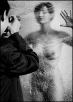

# 是真爱就不能没有悲剧倾向

晚上7点多钟离开办公室，走出公司大厅时路两边已经亮起我最喜欢的橘色灯光。昨晚睡觉前看[**王小慧《我的视觉日记**》](http://christina.tecinese.com/index.php?p=1779&c=1)，脑海中不断涌现出GRACE的形象，鼻子酸酸的。友谊和精神的依赖感令人在这个初冬清冷的夜晚更加脆弱！原来我离自己那么远，丢失已久......而面对她，能令我意识到还有理想和追求的存在。一个人怎么可能毫无压力的去享受生活？那么彻底，这让我不安！

昨晚看到《我的视觉日记》“燃尽的蓝蜡烛”中那个德国演员安佳斯自杀，其中写到安佳斯对王小慧说过，他这一生中只碰到过三个他爱的女人，都曾让他失望，王小慧是他碰到的第四个，王小慧是让他觉得现实与想象同样美好的一个人，这种内在与外在、现实与理想统一的人他没有遇到过。这种感情，在他生命中只出现过一次，虽然他知道王小慧不能给他以回报，但王小慧帮他实现了这个梦。

王小慧想是她的拒绝造成了他的死，但王小慧不可能不拒绝他，而且王小慧以为有时候仁慈便是残酷，而残酷便是仁慈。也许王小慧太无情了，没有给他留下丝毫希望？

安佳斯曾多次说过关于死亡的话题，比如说：生命终结了，痛苦也终结了。这个世界上美好的东西太少了，但真正极致的美总是给人以悲伤，总有悲剧色彩，因为它和消逝、幻灭总是不可分的。他信奉哲学家海德格尔的论点：存在的真正根基是虚无，我们被虚无抛出，又被虚无吞没。......安佳斯说他最喜欢的台词是歌德的一句话：“要想检验谁与谁可以永恒地在一起，要看是否一颗心能找到另一颗心！”

安佳斯送给王小慧诗稿的第一页上有一封信，没有称呼，只写着：

给王小慧—有的女人看去似乎是美的，因为外表漂亮或有吸引力，罗密欧说她们的脸上有着假面的影子。也有的女人有些美好的东西，但因为这只是一部分而非整体，所以留有很大一片空白及不协调。

一个真正美的女人是在美之上，所以她才真的美。一个真正美的女人是带有着某种神秘感的、纯粹的、不可触摸的、近乎完满的东西，所有这一切以一种和谐的方式统一在一起，这些成为她的可爱与可贵之处。......她的美也决定了她的行为方式：她保持了一些孩子式的天真，又有那个人化的、深沉的内心感觉。

真正的美有那么强的特殊的魅力，只有很少的人能认识到这一层的美。只有那很久而且很深地注视过真正爱慕过你而且自己也美的人，他当然会为你着魔并在心灵上受到巨大的撞击。他只有用一个微笑来宽慰自己—带着一只含泪的眼睛—一个丑角必须当心，他不能失去那只带笑的眼睛。

最后署的日期是1987年9月19日。难道这就是他对王小慧说的最后的话吗？他曾经对王小慧讲过卓别林，一个伟大的丑角总是用一个眼睛笑而另一只眼睛流泪。

**王小慧曾在电话里对安佳斯说：在我的生活中回忆和想象总是比现实更好些。安佳斯却说：我的回忆和想象与我的现实同样美好......**
