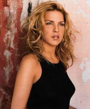

# 放肆幻听

昨晚观看Diana Krall在法国巴黎的演唱会的DVD，让人入迷。之前在这里介绍过她，可这是我第一次看到她的演出。Diana Krall拥有广大的歌迷，是25年来首位葛莱美年度最佳流行专辑奖项提名的爵士艺人。结果她以《温柔眼神》荣获爵士乐最佳演唱奖。

请到左岸喝咖啡———[**献给全世界热爱爵士的人们**](http://campus.sohu.com/59/85/article215418559.shtml)—[《THE LOOK OF LOVE》.MP3](http://mp3.baidu.com/r?url=http://www.rilken.net/download/The%20Look%20Of%20Love.mp3)  
所选歌曲:  
·DIANA KRALL《S‘WONDERFUL》  
·LAURUA FYGI《PERHAPS PERHAPS PERHAPS》  
·OSCAR PETERSON《UNFORGETTABLE》  
·LOUIS ARMSTRONG《LA VIE EN ROSE》  
·CARMEN MCRAE《TELL ME ALL ABOUT IT》  
·CLARESSA MONTEIRO《THE WAY YOU LOOK TONIGHT》
