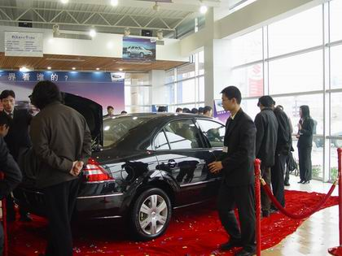

# 昨天记录

昨天起来已经十点多钟，外面下了雨。出租车的广播里正在报道的也是蒙迪欧南京露面的消息，赶到了大明路的福联，展厅里已经有很多人了。所有的销售和工作人员都穿了统一的制服，场面还算热闹。[**新款蒙迪欧2.0**](http://auto.sina.com.cn/z/fordmondeoss/index.shtml)分白色、闪电银、墨绿色、黑色、香摈色五种，我们选的闪电银色、尊贵版。

听说有人加价1.5万，想要和第一批客户一起在三月底提车，被销售人员当时谢绝。据说从去年开始预定此款车的南京客户已经有100位。到我们付款时，已有16位客户上午支付车款。新款的蒙迪欧较之老款做了很多改进，尤其我特别不喜欢的胡桃木内饰，现在是哑光效果，颜色更暗，看上去还是很不错的。  
—[***南京大明路上的福联专营店，统计下来，当天订出整整50台***](http://auto.sina.com.cn/news/2004-02-21/57368.shtml)—[***蒙迪欧以高性价比再度入市***](http://auto.sina.com.cn/news/2004-02-20/57357.shtml)

  

下午，和BESS、丸子看电影[《**蒙娜丽莎的微笑**》](http://ent.sina.com.cn/m/f/f/smile/) ，你想知道“蒙娜丽莎的微笑”是否代表了真实“快乐”吗？奥斯卡影后朱莉娅·罗伯茨主演，《蒙娜丽莎的微笑》(Mona Lisa Smile) 由索尼旗下的革命工作室(Revolution Studios)制作，《四个婚礼和一个葬礼》的导演迈克·尼维尔执导。

  
2003年12月19日是《蒙娜丽莎的微笑》在美国公映之日。在此之前，就已经有很多人在没看过片子的情况下大放厥词了。

英文中有个词叫“chick flick”，直译过来比较粗俗，叫“小鸡电影”说得文雅一点，可以叫“女性电影”。如果连电影都有性别之分，那么“性别歧视”这个东西也一定会如影随形。在女权主义叫得最响的美国，男性公民们却总是对“半边天”大不敬，他们用“给娘们拍的电影”来形容那些以女性为中心，男性则退居配角地位的影片。冷嘲热讽的背后是狂妄，心虚甚至嫉妒。

按照他们的标准，《蒙娜丽莎的微笑》是一部典型的“小鸡电影”。她的演员阵容是清一色的女星，而且在各大权力榜上跟汤姆·克鲁斯之类的“太阳神”平起平坐，让男人自惭形秽。

现年36岁的朱莉娅·罗伯茨在最近一次新闻发布会上开宗明义地说：“我们拍的不是‘小鸡电影’，我们拍的只是一部电影”。她接着说，自己之所以对电影中的20世纪50年代心醉神迷，是因为“那时女性的声音正处在社会变革的风口浪尖。

“故事里隐藏着一个强有力的话题，那就是女人该做什么，不该做什么。我们几乎从来没有在电影中公开讨论过这个问题。”

上周刚买[**SONY DSC F717**](http://dp.163.com/editor/030703/030703_275.html#)，顺便在新街口附近试试机器。玻璃天使的近拍效果，是我原来的DSC-P5做不到的。

