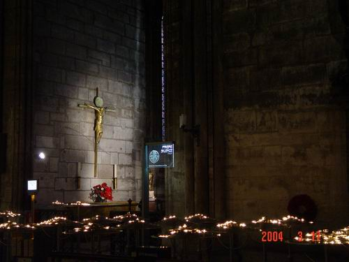

# TRIP IN PARIS-2004-03-17

hi,everybody,long time to see !

everything is going on well,but I met a big problem for the internet connetion to my own pc in Europe.

we stay in Germany for 2 days,1 day in koln to visit the international fair with david,and 1 day in frankfurt for sightseeings.

We have just arrived in Paris this afternoon from frankfurt by air.

I tried to update my website from the beginning of my trip in Europe,but I failed!!!you may don’t believe that in these european countries,it’s so difficult to find a place to get the intnet connection,even in the HOLIDAY INN hotel,I really hate this,otherwise I can record everything and update everyday and share with you,that should have been so great!but now it seems that I can only do it after I come back.what a pity.

We will stay in Paris for 3 days and after we will go to Italy,I hope we can find some place that I can succeed to make the internet connection with my own PC.

it is much more warmer than our imagination before,it is even warmer than in Nanjing.you need only to wear a shirt and a jacket max.so we have to carry these useless beatiful winter clothes everywhere.

this afternoon we ask our hotel for a place with internet connection,and they told us some places where there are internet cafe,well,we take taxi and went there,and now we can send these informations,by English only,because there is no chinese typing software,but you can use japanese,korean languages!!

it’s such a big internet cafe where there are more tha 150 pc here,and it is almost full occupied.

the people in our hotel told me that in France you have to get the permission first by the internet provider,and after you get a number for yourself and then you can get internet connection by paying 2 euro per hour.it is not like in china,we have so many public numbers in every city by paying from your telphone number that connect your pc.

so in France,a lot of people just go to the internet cafe.

well,my time in the netcafe will be over,I have to say bye,I think I will come back someday in this week!

I found this information by chance just now,maybe it will be a solution for my proble??

经常出国的商务人士或短期出国的旅游人士可以方便地在国外上网啦！5月21日，江苏电信在全省范围内推出名为“寰球e行”的互联网国际漫游业务，为用户提供在全球112个国家和地区接入Internet网络的服务。

特点：(1)快捷、方便、节省大量上网准备时间；（2）付费方式简单：先享受、后付费；(3)节省国际电话费用；（4）覆盖范围广：目前覆盖世界上112个国家和地区，通达海外7500多个城市。

申请办法：对于中国电信互联网注册用户，可直接在网上申请开通“寰球e行”业务；对于非中国电信互联网注册用户，则需首先到当地营业厅办理一个互联网注册帐号，然后再申请开通“寰球e行”业务。网上申请开通“寰球e行”业务的网址：江苏音符网站(www.jsinfo.net)-电信－上网用户服务：“窄带注册用户——开通/取消寰球e行”菜单下进行相应操作。

在网上申请开通/取消“寰球e行”业务的注意事项: 为了确认身份，请务必使用您所需要开通业务的帐号拨号上网。

资费标准： 漫游至美国、加拿大0.5元/分钟；漫游到欧洲及其它国家和地区0.9元/分钟，漫游费用计收在上网的帐号上，由用户在国内支付；在国外，用户只需支付上网时产生的市话费用。

业务漫游范围：美国、加拿大等112个国家和地区。

使用办法：用户下载并安装软件CTDialSetup.exe->双击软件图标，启动拨号软件->按照设置向导程序，对用户资料和相关属性进行配置(登录识别符为：用户名@js.cn，密码为在国内上网时所用密码)->配置完毕后，点击“连接”，登录互联网。

使用清单查询：用户可登录到江苏音符网站－电信－上网用户服务栏目查询使用详细清单。

作者：江苏电信  
相关：无  
出处：江苏电信

well,I paid 2 euro more so I can stay here for 1 more hour!  
paris seems to be so familiar to David,but I hate this place because I can not use my pc with internet conncetion,and people here are not so warm heated,I sunndenly start to miss LuGu lake in Yunnan,it’s a place far away from modenlization,but I can use my pc with internet connection.  
we can see a lot of good cars here which we only see from the car magzines before.the west foods are also ok for us,the room of hotel is clean with good equipment,and you can see old but brilliant buildings everywhere,especially In Paris.

there are so many chinese faces on the steet in Paris,and to my big pleasant surprise,I met the sister of David in the airport of Paris(CDG),I know she will arrive paris by air from beijing,and we had made the appointment in paris on March.17 for shopping together,but how can I imagin that we arrive in paris at the same time .by the way,she comes here for a publishing exhibition in Paris which is said to be a such kind of culture communication bewteen the chinese and French governments.

it’s 9:40 in the evening here!I have to go back hotel which takes 15 minutes by taxi.the hotel is in the center of the city which is quite close to the concord square.it is a very old building and the room is so small,but with a very big bed!and the washing room is as big as the living room.the window is big of old style,when I open it,so many old buildings which are so close to me give me such a romantic feeling …...

I hope a good time tomorrow and I will take many photos.wait and see!
