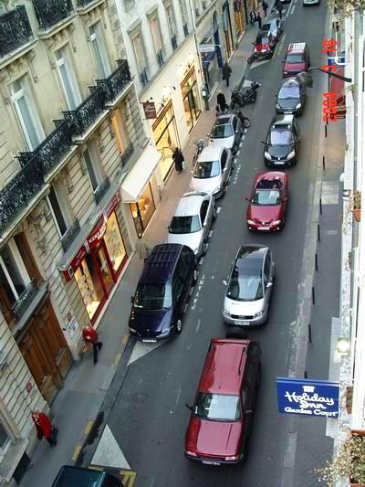
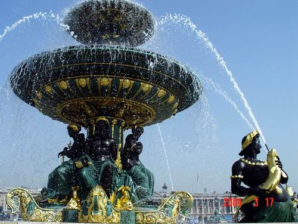

# hot sunshine day in paris-2004-03-18

so tired and hot.the tempereture in paris is more than 20 c under the sunshine at noon time.we took all the clothes which can be taken off.David told this is the 4th time he came to Paris but the 1st time he saw the sunshine.

 we got up at about 10 and went to Place de la concorde which is quite near by our hotel,after a short stay of 30 minutes,we walked straight along the road(champs-elysees) to ARC DE TRIOMPHE by 20 minutes.  
we passed by the LANCER shop and bought a nice bag which is new collection of 2004 as the saleslady said ,anyway,I love the color and style.

after a dinner in a chinese resterant,we went to TOUR EIFFEL by METRO.

nearby the TOUR EIFFEL,there is the brilliant building PALAIS DE CHAILLOT which is connected by a bridge crossing the RIVER SEINE,acturally this is the best place for taking photos for TOUR EIFFEL  
we didn’t go up to the top of the tower as there are too many people standing by.it’s pity for me,said by david, as you can see the whole old city from the top of the tower which is so brilliant and exicting.maybe next time,I will make up this.

afterwards we went to NOTRE-DAME DE PARIS which is the most famous church in the world which is on a small island in the RIVER SEINE.when we arrived,there was by chance a praying operation held in the church,a lot of people sitting there prayed following the god father.David spend 10 euro to get 5 candels and light them by praying something,I think it’s something about me and his carrer.

stepping out of the church,we walked along the RIVER SEINE and passed by the Boulevard saint-michel which is also a famous sightseeing in Paris because of the story in the bible.  

when we arrived in PONT NEUF,it was already close to dark,but the sightseeing was even beatiful and romantic,it is the oldest and most famous bridge in Paris with the history more than 400 years.there was also a movie” LOVE OF PONT NEUF” that I liked very much which was taken here,and I found some places that appeared in the movie which is so familiar to me.

we come back to hotel around 8 pm,and we both can not help sleeping even after taking a shower!you know,we spent about totally 6 hours on walking everywhere,incredible.

it is already near to 11 am!we have to go out of the net bar for LE MUSEE DU LOUVRE….......

---

## 评论（1）

**[Zoloft](http://www.buyzoloft.us)** · 2005-04-22

[Zoloft](http://www.buyzoloft.us)

