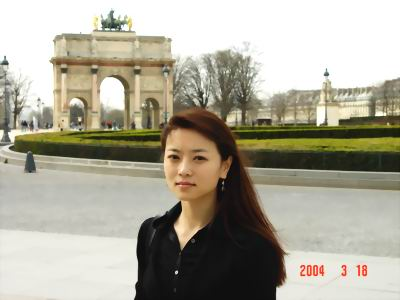

# 巴黎，难以言尽的魅力(一)

 16日下午3点35分的飞机从FRANKFURT飞往巴黎，行程只需45分钟。而乘火车的话，则需要3小时左右，不过选择火车可以顺便浏览沿途风光。3点55分左右飞机才开始飞上蓝天，4点30分左右到达巴黎戴高乐机场。我们居然在戴高乐机场遇见了DAVID的姐姐，她从北京飞巴黎，来参加中法政府间的文化交流。这的确令人感到意外和惊喜！

打车从戴高乐机场前往HOLIDAY INN酒店，高速公路上居然塞车，看见许多雷诺车，零星可见FORD、雪铁龙、意大利车、德国车，日本车在这里非常少见，德国和法国人民似乎比中国人民更加热爱购买和使用本土车，不过要是我们的本土车性价比也很好的话，谁会买进口车呢？我们新买的MENDEO在德国算是NORMAL层次的车，在这里卖到22750欧元。看见那么多雷诺车，便会让人想起BESS，因为她开的车就是雷诺。法国街头的雷诺车款式造型是我所喜爱的，这里的年轻人大多驾驶两厢车。另外，大街上摩托车比德国的要多一些。好象还是那种赛车式的，奔跑启动的时候声音特大。

到了法国的第一件事情仍然是向酒店前台询问上网的情况，回答与德国一样，必须用自己的帐号上网才行。如果我们通过国际长途拨号990的话，每小时需支付酒店750RMB的电话费，这简直太离谱了。服务生建议我们去不远处的邮局咨询一下。放下行李，走到邮局，还有一刻钟才到下班时间，但大门已经关闭，当我们试图向玻璃窗里的工作人员询问时，那个年轻的男人好象没有看见似的跑开了，NND~~

最后得知有个INTERNET CAFE通宵营业，拿着热心人写的地址打车过去，路上路过协和广场和许多不知名的古老建筑，震撼人心。

那个网吧里的人很多，估计有150台？可能还要多的电脑，空着的位子很少，几乎都满了。服务生给你一个电脑打印出来的纸条，上面写着日期时间，付费情况及用户名和密码，想必是随机的号码。原来这些法国人把工作、学习、收发E-MAIL以及上网娱乐打电话的事都放在网吧里做了，但没有发现有人在网吧里打电脑游戏的。另外和中国网吧区别的地方是，这里的网吧装修舒适简单整洁，色彩柔和，男士们都自觉到室外吸烟，空气非常好。从妇女到儿童，从老年人到年轻人，各类情况各类人种到INTERNET CAFE上网的都有，每小时2EUR。后来得知在巴黎包月每月支付200EUR，当然按照现在和人民币10.5的换汇来看，对于中国人是非常昂贵的。

3月17、18日停留在巴黎，在所有欧洲国家的首都之中，巴黎无疑是最富有魅力的城市，她的宏伟建筑和高水准的生活、美味佳肴以及高级时装令人赞叹。巴黎也许不再是作家HENRY MILLER曾经宣称的世界中心，然而，她充满着自信的特质并未消失。

巴黎有两个机场：戴高乐机场（ROISSY-CHARLES DE GAULLE），位于巴黎以北约23公里处。奥利机场（ORLY），位于巴黎市中心以南14公里处。全国优秀的铁路运作系统由法国铁路司SNCF经营。火车铁路遍及法国各地与欧洲铁路相连。火车一般分为头等和二等车厢。在高峰时乘坐超高速火车（TGV）和高速火车（HIGH SPEED TRAIN）需付额外费用。乘坐只有头等车厢的TEE也需增加额外费用。在法国购买任何火车票都需在站台入口处使用一种橘黄色的自动日期打印机打印日期，否则持无打印日期的车票的乘客将被罚款。多数法国火车站都接受签证卡（VISA）和美国运通卡（AMERICAN EXPRESS）付款。

欧洲火车在车厢接头处有供旅客摆放大件行李的货架，由于西班牙火车爆炸案，现在要求乘客必须随身摆放行李，即使是很大的行李箱，无人认领的行李由列车管理人员处理。未出发前得知一个熟人在比利时的火车上，行李就是摆放车厢接头处的行李架上丢失的，头等车厢的火车票价高出二等车厢的30-40%。法国头等车厢的氛围令人窒息，那些穿着讲究的商务型男人和女人们，从不翘二郎腿，永远保持矜持的坐姿和眼神，即使有人在车厢里聊天，也很安静，连揉个纸团的声音都显得那么的刺耳。  

对初来乍到者，巴黎似乎是个不折不扣的国际大都市，尽管美国连锁快餐店以及英式法语逐日增多，但其实她仍然保持着典型的法兰西文化内涵。目前，法国是全球无人驾驶地铁最多的国家，巴黎拥有世界唯一的全自动无人驾驶地铁。METRO译为地铁，是METROPOLITAIN的缩写，即地铁站。在巴黎市区，平均没平方公里至少有3个地铁站，无论哪个街区角落，一般只要步行几分钟便可找到一个地铁入口。地铁站以METRO为标志，或仅有一个缩写字母M。巴黎于1900年开启第一条地铁线，至今，共有14条市区普通线和5条郊区快线，上下至少有3层，越往下地铁速度越快，停靠站点越少，。只要利用好道路标识，乘坐四通八达的便捷地铁，你就可以进行轻松愉悦的巴黎旅行了。

我和DAVID手持一张巴黎地图（一般酒店会提供给你），乘坐地铁参观景点，每人需付1.3EUR，只要你不出站就可随意换乘地铁。在地铁里识路及辨认站牌、指示标记会比乘坐出租汽车更有乐趣些，和当地居民也有很近的接触。这是自助旅行有意思的方面！据说，现在巴黎地铁里的小偷也很多，居然连当地人都偷，有的小偷穿着体面，还有指使小孩偷窃的。

巴黎出租车的起步价和德国、意大利差不多，为3-4EUR，如果携带大件行李还需行李费，一般3-5EUR不等，这和支付小费一样，大家心照不宣。司机会比较热情地帮你搬运摆放行李。如果乘出租车在巴黎旅游的话，你得准备一大笔钱去支付车费。

法国时间16日傍晚到达巴黎我们预定的HOLIDAY INN酒店，和FRANKFURT的HOLIDAY INN相比，这里的连锁酒店的确要小一些。这让我想起云南丽江的那些客栈。法国人对卫生间非常注视，器具崭新，装修典雅，在卫生间和起居室各有一个欧式落地窗，白色窗框，镶嵌着白色磨砂玻璃。窗外临街是一条窄窄的街道，汽车摩托车行人从窗下过往，四周都是几百年前留下的建筑。

 

我们居住的酒店步行到协和广场大约十分钟左右，总统府也在酒店附近，据说便衣警察常常巡视在四周街巷里。与德国人良好的英语相比，法国人不怎么说英语，看着满街飞驰而过的大多是雷诺和标志车，（偶尔可见意大利和德国车，日本车很少见。）你就知道法国人有多么支持他们自己的产品和企业，就知道他们有多热爱自己的民族。

拿着在中国挣的MONEY去巴黎消费，永远都有囊中羞涩之感。在酒店附近一家叫做“香根菜”的中国餐馆里吃午餐，我们点了下面几个菜：酸辣汤、云吞汤、炒三鲜、广东炒饭、麻泼豆腐、葱炒羊肉，最后帐单上的数字够在国内请十个人吃一顿很不错的大餐了。

“菜根香”装修典雅，玻璃门上一尘不染。那里的中餐馆，受环境影响从装修到情调等等方面也会渐渐具有法国味。餐馆里的香港打工仔告诉我们，他们不愿意接待中国旅行团队的生意，因为他们喜欢大呼小叫,大声喧哗，甚至围观邻桌人餐饮，弄得法国人很纳闷也很烦感，影响了他们店里的生意。他甚至亲眼看见旅行团队里的一个中国人（指大陆的）将一口痰直接从二楼吐到一楼的地上。

随地吐痰现象在中国并不稀奇，据巴黎的华人讲，法国报纸、台湾报纸、中文报纸都曾报道过中国旅行团队居住酒店，离开后把酒店房间内弄得“一塌糊涂”的新闻，后来那些接待中国团队的酒店，要求加收25%的服务费。究竟是什么程度才能称之为“一塌糊涂”，中国和法国是不是永远不会有一个相同的标准？？？在火车上我观察过那些乘客，他们吃完餐点后，会把桌面收拾的干干净净。说话声音非常轻，尽量不直接和你的视线接触，接触到了，大多报以微笑。法国人也会观察你，但他们不会毫无顾忌一直注视着你，这或许是他们行为礼貌中的衡量标准之一吧？！你可以轻易在意大利找到翘二郎腿的人，但在法国和德国却不那么容易。

   
在“菜根香”饭店的午餐

法国的空气中充斥着香水、咖啡和面包的香味。巴黎人穿着精致、比较有品味，巴黎的女人大多喜欢佩戴带首饰、太阳镜，喜欢穿裙子、着透明的黑色长统丝袜、靴子或者浅口鞋。法国女人既有东方人的小巧（身高普遍在1.65-1.70米间）以及皮肤的细腻感，又有西方人的立体感。在巴黎街头看多了法国人的脸，偶尔遇见一个亚洲人，那感觉仿如从高山跌落到平原上一样。我常在巴黎街头向DAVID感叹：“人家那身材真是好，多挺拔多立体啊......”后来去了意大利和丹麦，包括之前的德国，我还是欣赏法国女人的美。

   
**SMART**车多见于德国和法国街头，可爱的法国男人吃着棒棒糖，在新桥（PUNT NEUF）上等候信号灯

---

## 评论（3）

**kuang** · 2006-01-08

您好！很喜欢您的文字。  
  
今天偶尔在淘宝社区又看到您这帖子，您竟然在淘宝卖起天津特产来了？不大可能吧？所以还是来这里告诉您一声，这是淘宝帖子的链接http://forum.taobao.com/forum-11/show\_thread----3442926-.htm

**[kuang](http://forum.taobao.com/forum-11/show_thread----3442926-.htm)** · 2006-01-08

上面的网页链接错误，试试这个http://forum.taobao.com/forum-11/show\_thread----3442926-.htm

**[kuang](http://forum.taobao.com/forum-11/show_thread----3442926-.htm)** · 2006-01-08

不好意思，由于这里可能对粘贴链接有限制，所以不能显示我粘贴的网址，您直接点击我的名字即可。

