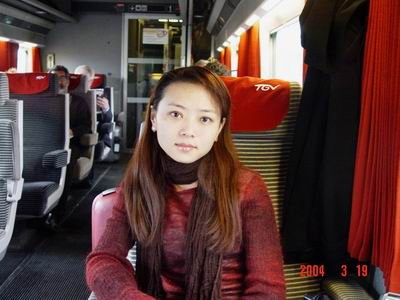
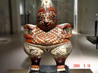

# 巴黎，难以言尽的魅力（三)

第二天乘地铁去了卢浮宫和艾菲尔铁塔。想起我们最初在那个地铁站唯一一台自动售票机前买票的情形，投币进去，票从里面跳出来，我们两有那么点小兴奋，因为开始的时候没有发现显示屏上可以选择英文指示，所以费了点周折才买到两张地铁票，买票过程象是在玩游戏机，乐趣随之而来！

第100期《旅行家》上报道2004年2月12日中国和申根国家中的12个国家签订了旅游协议，大概5月1日中国公民就可以参加旅行团前往这些国家旅行了。我们中国人旅行大多喜欢走马观花地看看目的地景点，而忽略这些当地比较本色比较特别的细节。建议旅行团安排诸如有关地铁等方面的实践和体会。记得一个人参加旅行团去泰国，和两个导游厮混的熟了，晚上和他们去当地酒吧玩，一起去吃夜间大排挡，接触到旅行团之外的当地生活层面。有时，参加旅行团就好象还处于自己人的环境中，如果我们不自己买票，自己去乘火车，而是和一大堆本国人去做这些事情，我们或许体会不到车厢里聊天但凡窃窃私语以及无人翘二郎腿的情形，和一大堆人坐在街角的咖啡椅上面对人来车往的街景，你又何曾有心情去体会当时的感受？我们可能会和在国内一样，放肆我们的嗓门和眼神，我们也不会有机会问路并与被问路的当地老人开心地聊天......

  
TGV超高速火车

   
出租车上的卫星导航定位装置

第100期《旅行家》上有篇文章名为《初吻巴黎》，摘节题头文字如下：  
尽管几乎全世界的人对艾菲尔铁塔、卢浮宫、巴黎圣母院都耳熟能详，但真到了巴黎照样犯晕；尽管每年有7000万各色游客在巴黎大街上熙来攘去，但巴黎照样轻易地让老练的旅行者眼花缭乱！所以第一次到访巴黎，必须也只能走马观花那些早已如雷贯耳的名胜，浮光掠影那些早已烂熟于心的经典。

初踏巴黎，从机场到酒店的路上，迷失在雷诺、标志车流里；  
进入城市，迷失在铺满青石的马路和古老建筑中；  
夜间，迷失在几百台电脑的网吧里；

白天，依然是迷失，迷失，最终迷失在卢浮宫殿中，也迷失在那些美丽神奇的胴体雕塑和绘画作品里......摇滚乐的鼻祖约翰.列侬原先是美术学院的学生，有一次老师让学生们画船，交作业的时候，约翰.列侬的作业上画着一对夸张的乳房，约翰.列侬偏爱人体绘画，而我也象男人一样喜欢欣赏女性的乳房，并且喜欢身材好的人。这仅仅是个人爱好罢了。之后约翰.列侬若不是被美院开除，也就不会诞生一个久负盛名的摇滚乐明星！

卢浮宫里那些艺术品和严肃的交响乐一样于我们都是浪费，我甚至感到脸红，我们再以怎么崇高的心态去膜拜这些艺术，都是亵渎，8.5欧元的门票在这种状况下显得奢侈，除了耳熟能详的几件作品外，其他的一无所知。看见当地的学生由老师领着在卢浮宫里上美术课、历史课...真想坐下来贪婪地听一听。这个机会对美术学院的学生一定是非常有意义的，而，我们，象猪八戒吃了人参果，吞下去到现在还不知道什么滋味。正如第一次听完交响音乐会出来，当有人问：“音乐会怎么样啊？”我尽无言以对，只好缄默着等他人回答。

艺术是人类精神的体现，想象力把这种精神转化为艺术，而那天，我们就是两个面对艺术的白痴，只能把卢浮宫当作景点来参观。什么都是空的，包括视觉反映到大脑里的影像也是苍白且无力的，我们该如何理解这些艺术品的前因后果，以及艺术本身的精彩和震撼？！希望将来可以有机会学习对这些艺术作品的认识和理解，然后，再去感受卢浮宫。

（当时我们询问过卢浮宫里面租的带耳机的讲解磁带，除了中文没有之外，大多数语言的讲解录音都有，所以只好看着别的游客戴着耳机，滋滋有味的欣赏艺术作品，当时，我们就五个字的感受：羡慕、嫉妒、恨！）

   
   

   
普西莎及爱神

   
在卢浮宫里上课的老师和学生

    
左图：入口处指示牌  
右图：卢浮宫自动售票机

    
左图：萨莫屈拉克胜利女神  
右图：背面的米罗岛的维纳斯

   
老师安排这些学生正在临摹的是“书吏坐像”

    
左图：Christina的微笑  
右图：埃及馆

    
楚毕库阿罗像（墨西哥）

