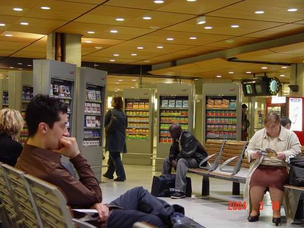

# 法国女人和中国女人

*转载一篇文章，作为文字上向法国告别。*

女人这个话题，不光中国人有兴趣，法国人也有兴趣。在一次法国女人和中国女人异同的讨论上，我用一幅画表达我的看法——这幅画左边是半个法国女人，右边是半个中国女人。那么，法国女人和中国女人到底有哪些不同呢？

首先，中国人是黄种人，法国人大部分是白种人，但是这个白种人个子不高（法国男人在欧洲人中个子也是偏矮的），纯正的金发碧眼也不多。像著名演员朱丽叶·比诺什（JulietteBinoche）那样的袖珍美女比比皆是。要说，让中国男人受用的除了身材不高之外，法国姑娘很细腻，不像美国女孩那样咄咄逼人。法国地处欧洲中部，性格上不像南部的意大利和西班牙人过于热情，也不像北部的德国人以及北欧人那样古板和严谨。总之，对中国人来说真是刚刚好，这恐怕也是人们通常说“法国是欧洲的中国，中国是亚洲的法国”的原因之一。

在待人接物上，法国姑娘普遍没有中国姑娘的矜持。在法国男女相识是一件很容易的事，所以我怎么解释法国人就是不能完全理解“红娘”的含义。

从服饰打扮看，法国女性的穿着远远不如我们想象的那样，尤其是年轻的女孩甚至可以说是单调和朴素，基本上是休闲风格，以牛仔裤和各种T恤为主，穿裙子的很少。因此我画的那幅画中，法国女人穿的是背心、短裤；中国女人穿的是旗袍。在著名的香榭丽舍大街，倒是有许多身穿名牌的时髦女郎，但是如果稍加留意就会发现她们大部分是外国人。

我那幅画的第三个突出点是，法国女人手上夹一根烟，中国女人手上拿一把伞。法国女人抽烟之多实在出乎我的意料之外，在法国抽烟的女性人数肯定远远超过男性，在大学校园、咖啡店、餐馆，甚至火车的车厢里都能看到大批的吸烟女孩，浑身发出一股不让人喜欢的尼古丁味道。

中国女人手上总拿一把阳伞，因为中国女人要“一白遮百丑”，法国女人却以古铜色皮肤为美，但是古铜色皮肤又不是天生的，因此法国人一有太阳就晒，而且晒太阳还讲究不留死角，所以一晒太阳就得脱衣服，在凡尔赛的人工湖边的草地上我遇到一位半裸的。据说，法国人最讨厌的倒不是中国女人的白，而是日本女人的白，认为那已经是不健康了。有趣的是，法国的化妆品广告，在法国是绝对不提美白，一到中国来也只能入乡随俗。

法国人把“漂亮”与“美”分得一清二楚。有的女孩年轻活泼、身材很好，脑子却空荡荡的，这种女性最多只能算“漂亮”。相反，有的女性身段、五官都不出色，穿着打扮也不特别讲究，却散发着一种不可抵挡的魅力与气质，这样的女性才会被法国男人称为“美人”。

法国的男女通常要经过同居阶段，合则聚不和则分，不过年龄越大越稳定，通常40岁左右又有孩子结婚的可能性就相当大。我请教Gayannée法国女孩一般有多少个男友，没想到这个简单的问题难倒了她，她歪着脑袋想了一会问我，怎么界定男友？一夜情算不算？我愣了一下，回答说不算。她又歪起了脑袋，我想不难为她吧，提示地问她，10个男朋友算不算多？没想到她又反问我，你是指一年吗？我的天！

像其他欧美国家一样，法国的离婚率也居高不下。我问法国朋友法国的家庭中一般谁做饭，他回答说这要看具体情况。我问典型的家庭呢？他回答说一个典型的家庭是离婚的家庭。法国女性相对比较独立，不知道是独立性高导致离婚率高还是离婚率高导致独立性高？许多法国女性结婚后经济上自我独立，各人有自己的银行账户，日常开支丈夫负责水、电、煤、电话，她负责食品，房租一人一半，小孩的教育也一人一半。这种生活方式给中国人的感觉是不亲热，像准备随时离婚似的。我开玩笑地告诉他们，在中国你们这样不叫家庭，最多是一种生活共同体，因为，我们在做研究时，对家庭的定义是:第一，家庭成员共享收入和消费;第二，家庭成员每周至少5天生活在一起。

这种独立的好处是法国姑娘不那么嫌贫爱富。这一点从法国的征婚启事也可以看出，在法国男人刊登的征婚启事中，他们往往会详细介绍自己的爱好兴趣，包括喜欢看什么书、平时都欣赏什么电视节目以及喜爱从事什么运动等。再看看中国男人的征婚启事，上面罗列的都是他们的“成就”，其中最重要的无外乎他的经济状况、学位以及有几居室的房子等。中国男人似乎不需要夫妻之间的心灵沟通，至少这种沟通不是最重要的。

除了外貌，中国男人择偶的另一个重要标准就是年龄。翻开报纸、打开电视，你会发现，征婚者无一例外地要求女方的年纪比自己小。法国男人也注意女人的年龄，否则沟通起来就有问题。但他们不特别要求女人一定要比自己小，大几岁也无妨。所以，他们在征婚启事中给出的年龄段通常是自己的年龄加上或减去5岁，我就知道一个男朋友比自己小12岁的法国女士。

相比之下，中国的婚姻似乎更重视一些外在的东西，就像那句老话说的那样——郎才女貌，中国女孩要是嫁给黑人一定会招来蔑视的眼光，只有嫁白人才能光宗耀祖。至于中法之间，谁的婚姻质量更高？恐怕要专门地研究才能回答。

巴黎火车站  
   

---

## 评论（1）

**[征婚](http://www.iou365.com)** · 2004-11-13

除了外貌，中国男人择偶的另一个重要标准就是年龄---- 外貌 年龄 知识水平 资本 四个方面各有各人的侧重.

