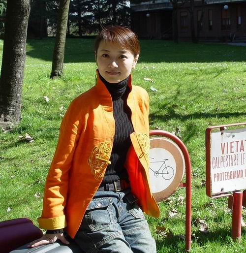
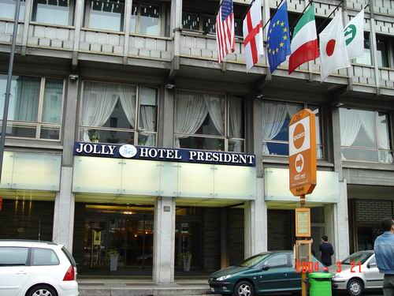
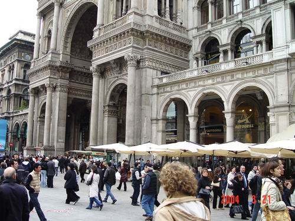
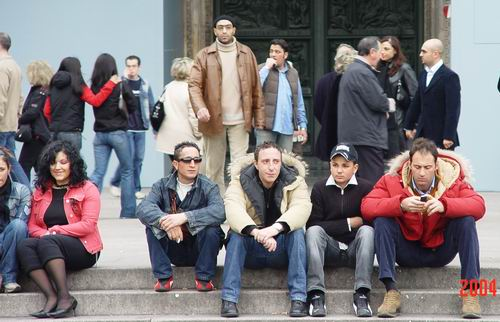
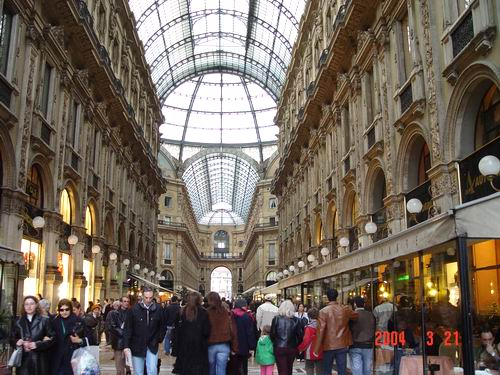
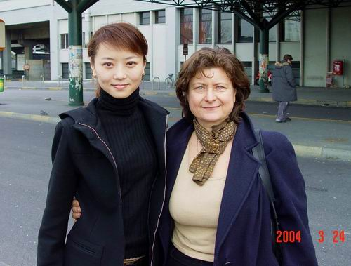

# 在米兰的早晨醒来

**3月21日**上午从法国NICE乘意大利的火车前往米兰，过了意大利边境，隔壁邻座坐了一对夫妻和两个小孩，他们吃午餐热闹的声音使车厢里渐渐开始嘈杂起来，其中一个小女孩透过座位的缝隙对DAVID不停嬉笑。过了中午到达意大利米兰。出了火车站，跃入眼帘的广场上是一堆一堆的阿尔巴利亚人、俄罗斯人、吉普赛人、中国人，这些在米兰找生活的人，衣衫褴褛、眼神压抑直楞，三五成群地游荡在火车站四周。并且看见和中国一样售卖假名牌皮包的摊子，就在火车站出站口处。后来在威尼斯也看见同样的情形。小说《身体上的国境线》中的“我”在北京国际机场等待的，那个笑起来让“我”感到白昼摇曳的光影忽间发生了细微的转变的意大利女子依莎贝塔，“我”在她那柔美的曲线上曾经奏响过生命中最热烈的一曲弦乐......在米兰街头的人群中，她究竟是怎样一种气质的女人？我不禁开始寻找起小说中依莎贝塔的形象。

朋友把我们接到他帮忙预定的JOLLY HOTEL住下，CHECK IN时酒店告之第二晚的房价要涨50%，当时米兰有会议举行，所以酒店几乎满员。安顿下行李后，我们步行到座落在米兰市中心的杜奥莫广场上的[**杜奥莫（Duomo）主教堂**](http://www.youer.com/jingdian/jingdian231.htm)，是欧洲三大教堂之一。主教堂大厅面积1.17万平方米，可容纳3.5万人，1805年拿破伦 曾在此举行加冕典礼，成为意大利国王。广场上熙熙攘攘，是此行我们在欧洲看见人种最全的国家。往北漫步经过斯卡拉歌剧院，就是最集中的名店群，却是由很窄的小街所载，这里就是MonteNapoleone。意大利的名牌如Gucci,Fendi,Prada,Bulgari以及Ver鄄sace,Armani系列，外国牌子什么LV，Cartier等等等等也盛装出场。在这种精品店买东西，比国内低20-30%，不同牌子便宜程度不同，再加上16-17%退税后相当于6到7折了。而我们由于时间原因所购买的商品都没有办理退税，DAVID说就当为欧洲人民做贡献了~~四处逛了逛已是傍晚，我们步行找到一家名为“天津饭店”的中餐馆吃晚饭，菜价明显比巴黎的要低许多，云吞汤和酸辣汤一碗均为2.5欧元，而在巴黎则卖到3.6欧元一碗。晚饭后打算仍然是步行回酒店，但最终还是迷路了。那些看起来差不多的街巷让人眩晕，路上没什么人，按理杜奥莫广场是米兰的市中心，怎么夜晚却透着一种莫名的萧条和荒落感。夜色越来越深，打车回到JOLLY HOTLE。

**3月22日米兰的早晨**，噩梦中惊醒。梦里发生的都是老故事，一遍一遍地重复出现在梦中，醒来后继续延续着梦中的压抑和难过，不要这种痛苦成为现实，但它却仍然在梦里纠缠着我，深入骨髓，丝丝透着心寒和绝望。

[**更多图片**](http://www.imagestation.com/album/?id=4287293221)  
—”为什么有人会迷恋旅行呢？我想是因为他们觉得自己的日常生活过于平庸乏味，眼界过于狭小，希望暂时从中摆脱出来。他们希望能够看到奇异的风光，体验到新鲜的乐趣，这回使他们觉得自己的生活有了某种程度的转变。我也喜欢旅行，但和其他人有所不同的是，我发现和人的相遇也能让我感到处于一场旅行当中。可能是和朋友相对而坐一起聊天，也可能是与人在床上一起缠绵。男人和女人的相遇尤其像是一场旅行，而如果他们相遇的开始就注定会要分手那就更像一场旅行了。”这段来自小说《身体上的国境线》。

**3月24日**从威尼斯又回到米兰，临近杜奥莫广场的路上向几位意大利老人问路，其中一位穿羽绒背心的老人问我们从哪里来，我们说从中国来。他特别兴奋地告诉我们他12年前去过中国成都，他是医学教授，说成都是个非常脏的城市，当时他在一所医科大学。一天早晨，他在校园里看见学生嘴里念念有词，好似念经一样，走近之后才发现他们在念英语，他有些奇怪中国的教育方法。当时，我看着他的表情忍不住地笑起来，他问我：“你很漂亮，为什么要捂着嘴笑？”我说我的牙不好看，接着我又笑，仍然习惯性的捂着嘴，他和他的妹妹上前来拽我捂嘴的右手，没想到我的左手不自觉地接替了右手，他们又来拽我的左手，哈哈哈哈~~DAVID在一边看着笑得不行。这位老人现在半年在美国半年在意大利工作，说了一口流利的英语，巧的是他的女儿也叫CHRISTINA，是家电话公司的CEO，他要求我们给他留下E-MAIL，如果有需要可以让他女儿和我们联系。告别前，与几位和蔼可亲的老人拍下合影。

在米兰一半的时间DAVID都在工作，所以有机会来到米兰新区那个当地人所谓的富人区。据介绍那里的房子每平方米售价为3-4万RMB，真不如南京月牙湖一带的环境和设施。意大利语在我看来是很吵的语言之一，舌头在口腔里是甩动的，发音“咕咚咕咚”的。以前有过念头打算学习意大利语，南师大就有意大利语培训。如今我对意大利语没有兴趣，因为太吵太不柔和了。在意大利米兰全然没了在巴黎时的优雅和安全感，倒是米兰冷清的夜晚，给我留下了深刻印象。

   
**~~-给我们指路的意大利老人~~**

   
**-JOLLY HOTEL**

   
  
   
**~~-杜奥莫广场~~**

  
**-满脸疲劳的我与犹太女人**
