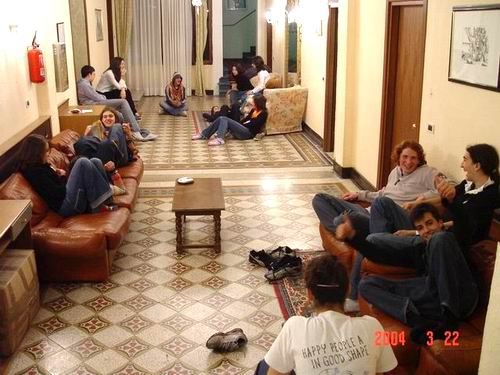
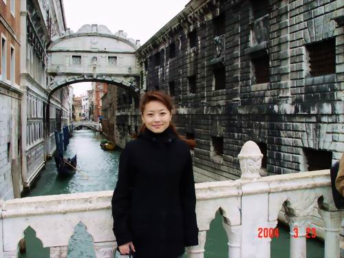
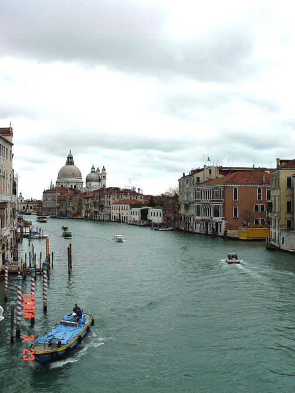
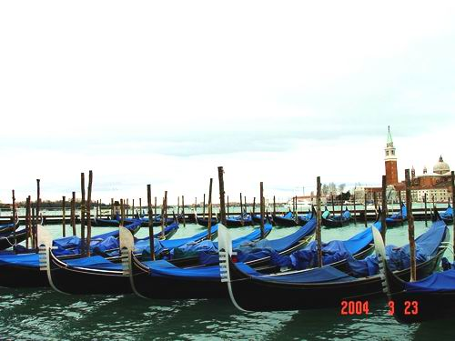
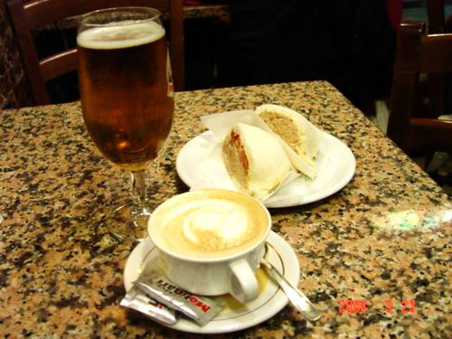
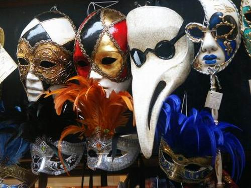
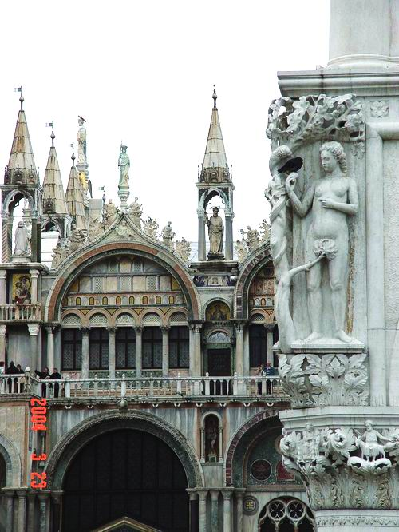
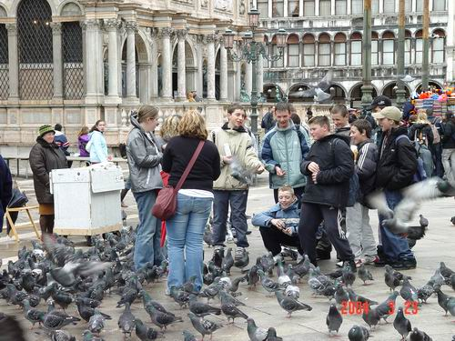
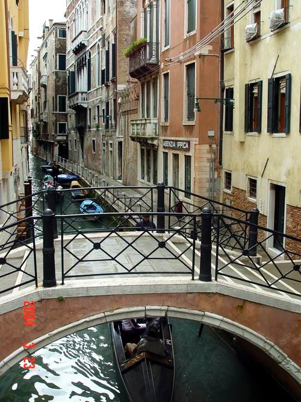

# 水城威尼斯

从米兰出发前往威尼斯的途中，打算用本子记录一下过去几天的情况，顺便听听随身携带的CD，是这次旅行中第一次听中文歌曲陶吉吉的《乐之路》。一上来第一首就是《回家》里嗲嗲的上海话，亲切至极，不仅亲切而且贪婪、陶醉、入迷......听到了第5首《天天》时，泪水象自来水似的开始哗哗地往下流，人整个融化在歌声里。窗外一抹淡淡的夕阳，景物飞速朝后奔去，树影光掠，我开始想家想中国了......

到达威尼斯已是3月22日晚上9点多钟，出了火车站左拐没几步有家二星级酒店，90欧元每晚。店家对我们即将入住的房间连续吆喝了几遍“VERY NICE”，待我们进入房间才发现，这是一套位于顶层顶里面，并且窗户用木质卷帘封闭的、有着一个极其不安全天井的房间！！！顶层除了我们根本没人居住，我当即提出来换房。小心圆滑的意大利人......

换到二楼，和一群热闹的意大利学生同住一层。每当我们早出晚归，必然遇见他们横七竖八的聚集在酒店客厅里，不知道他们在聊些什么，但会被他们开心的笑脸和气氛所感染，甚至有一次深夜12点了，我们听见他们还在客厅里嬉闹的声音，听见他们恶作剧地敲我们的房门，然后忍不住笑着逃走。

 —前面提到的那群可爱的意大利学生

23日上午威尼斯还在下着雨，交通工具除了船之外，只能步行。威尼斯是由纵横交错、宽窄各异的水道隔开的小岛组成的。随着时间的推移而不断变迁不管完善。市区里陆地4公里、离海边2公里。应该提及的是，由于已有160多条水道淤塞成陆地，威尼斯目前岛屿数量已减少到了18个，其中包括大圣乔治岛和久德卡岛。

今天的威尼斯基本上还是13世纪的样子，只有个别建筑物因进行过部分修建而改变了摸样。但这不影响城市总体布局。

我们步行到圣马可广场（PIAZZA SAN MARCO），它是意大利建筑的一块瑰宝。广场包括主体和临海的小广场。广场四周屹立着艺术价值很高的建筑佳作：圣马可教堂、总督府、连拱廊和高高的钟楼。在前往圣马可广场的途中我被那些奇异的、五彩斑斓华丽的面具深深吸引，非常漂亮的面具，稍微精致的和人脸差不多大小的面具，一个需要支付60-80欧元，相当于人民币600-800元。回国后听朋友说国内就有出口这种面具的。

[**更多图片**](http://www.imagestation.com/album/?id=4287269513)

 —站在“叹息桥”上的我  
横跨总督府和监狱之间的狭窄的府第溪道上空的小桥是威尼斯最著名的古迹之一。在数个世纪中它一直是一条令人抑郁的通道。囚犯们从监狱提到法庭审讯时总要被迫走过它，审讯后再回窄小黑暗的牢房时还要穿过它，犯人们过桥时往往会发出叹息，因而得名。

 —威尼斯的大水道（CANAL GRANDE），是贯穿威尼斯全城最长的水上街道，近4公里长。顺水道观光是游览威尼斯的最佳方案。过去大水道曾经是威尼斯的门户，是这个富裕共和国的通商口岸。随着时间推移，它已经失去了以往的地位，以前的港口不止一次的变迁位置。今天的大水道成了威尼斯的“迎宾河”。

 —威尼斯尖舟有一个独具特色的名字“贡多拉”（GONDOLA）。这种轻盈纤细、造型别致的小舟已有一千多年的历史了。它一直是居住在泻湖上的威尼斯人的代步工具，第一任总督将这种船命名为“贡多拉”。

 —[**MOLINARI CAFE**](http://www.caffemolinari.com)店里这种白色面包片夹着吞拿鱼沙律的食品是我在欧洲最喜欢吃的，非常怀念那种口味。

   
威尼斯面具

---

## 评论（1）

**lezhi** · 2004-04-08

christina, 今天在imagestation上看到一个面具的album  
看这些，有颓废的美感，好像世界末日，好像要沦陷。不知道为什么，有种特别的伤感。不知道面具下面的人是怎样的心情.看起来那么落寞.  
还有一些很搞笑的.连小狗都戴面具，穿华丽衣。  
也有看起来很骇人的.

