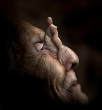

# 超越现实，但依然不是梦

 当你发现你离某种感受越来越远，而且那种感受也越来越淡的时候，你浑身开始轻松。无论之前如何禁锢着人们的快乐，轻松即意味着超越！

事实上，你并不想超越，好似压抑时尽快捧起书来阅读的方式，那必须是一本以你喜欢的表达方式写出来的书，它可以使你摆脱一切现实社会与自己理想世界相斗争相妥协的令人窒息的状况！

你知道你经历了之前最糟糕的遭遇之后，你变得聪明而玩世不恭，前者有助于你判断，后者有助于自我保护！可现在还能保护些什么?

---

## 评论（1）

**shelley** · 2004-05-22

christina,这个是你的新博吗？

