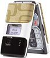

# @$^%$&(*

 托好友GRACE从香港带回[**诺基亚7200**](http://forum.younet.com/13649.html)手机一部，准备更换偶的那部西门子SL55，手机还没拿到手，另一热心好友已经告诉偶7200的众多缺点·##%……%……￥！……靠！已经被贬的一无是处了？会不会是托儿？偶要的不过是买手机和换手机的快感，早知这样，不如让其帮偶买水货得了！最让偶无言以对的是偶手机没拿到手，偶买这款手机的消息隔了两层楼办公的GGJJDDMM们都晓得了，这真是个信息快速传递和发达的时代！

年初较冷时在东方商城买了件夏天穿的无袖上衣，春天刚过那件已经打了三折出售，靠！！！偶还没穿就打折了？什么狗屁品牌啊？偶痛恨的一踏！这使得偶越发崇敬那些从不打折的商品。
