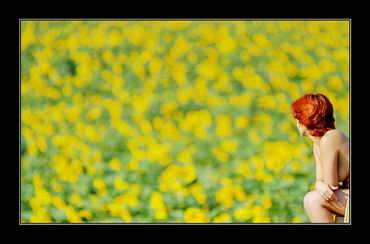

# 象只虫子

上周末喝酒喝到吐，“*我的儿子*”背我下楼，听说那风度真的很英雄味，拉着我的一只胳膊顺手就把我带到他的肩上，二话没说。喝醉的感觉虽不好，但吐干净就没事了。后来*“我的儿子”*在电话里对我说：“你是笨蛋啊，什么都不知道了......”*“我的儿子”*这个绰号是他们自己圈子里起的，我也乐呵呵地跟着叫，他每次都害羞的笑。好象他们不象中国人那么介意孙子、儿子的称呼。

有时，感觉外国人比中国人要认真。我们无法象只虫子一样生活在自己的生活之外。
