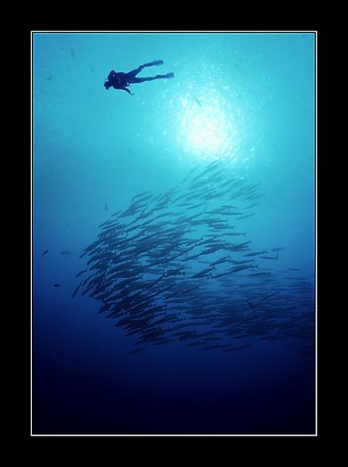

# 背景音乐《鳟鱼》

黄国俊 – [《**鳟鱼**》](http://61.128.101.130:4080/song/k4/0204/10.wma)

我逆流而上　  
去寻找逝去的时光　  
沿途处处是险滩   
没把握回到你身旁　  
想破镜重圆　  
像鳟鱼奋力倔强　  
是谁在阻挡命运始终和我对抗　   
啊　MISSING YOU　  
爱人好难　  
过去可否都不算  
依然LOVING YOU　  
路好长　  
不能让你再（有）绝望  
　  
河流太顽强  
鳟鱼它什么都不管　  
爱没有答案　  
它只是一路往前闯   
那是一段最初美好时光　  
有好多纯真被遗忘　  
不懂我会粗心大意  
把真爱当作像空气样平常

啊　MISSING YOU　  
爱人好难　  
过去可否都不算  
依然LOVING YOU　  
路好长　  
不能让你再（有）绝望  
　  
纵然成功只千万分之一  
我还是不怕再回去　  
你永远都是我　  
我生命的唯一   
唯一不能没有的世界
