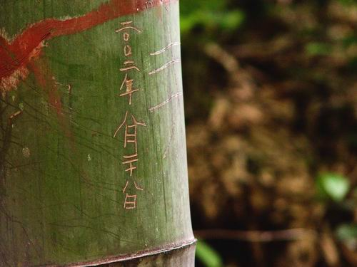
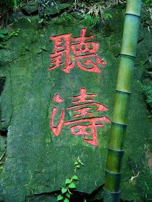
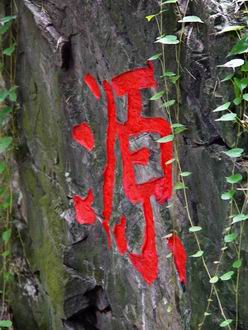
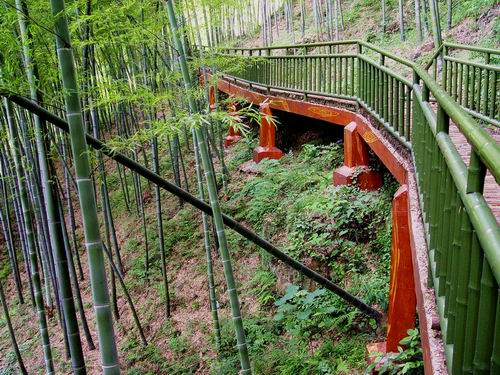

# 竹

---

## 评论（7）

**jintaixun** · 2004-07-12

ni zai ganma? zheli meiyou zhongwen....  
wo hen xiang ni^^ hahaha. nine?

**[雨浓](http://www.ruofei.net)** · 2004-07-12

哇 环境很美 c依然很漂亮  
  
太喜欢了

**[atbyin](http://www.atbyin.com)** · 2004-07-13

一个颇有厚度的女人。

**Christina** · 2004-07-13

**年轻的美会让人记忆更深，成熟的美能让人记忆更久......**  
  
-1995年摄于南京清凉山公园，那年21岁，喜欢笑，可是笑容里什么也没有，象一汪清澈的水。想起席慕容的文字“如何让我遇见你，在我最美丽的时候...”  

**[Raymond](http://www.livejournal.com/users/drsaddam/)** · 2004-07-21

I love both of these photos of you, Christina! You have such an effortless beauty. :)

**carinejin** · 2004-07-22

christina姐姐很上相

**[streetlight](http://www.isblogger.com)** · 2004-11-24

真的很美

