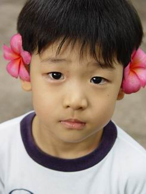
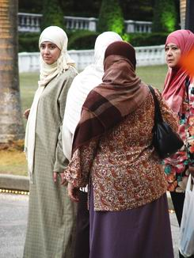
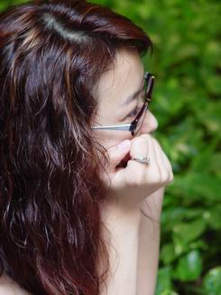
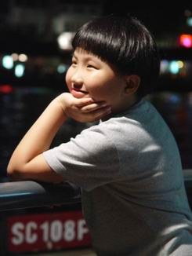

# 早晨回到南京

凌晨一点多钟的飞机从新加坡飞南京，应该六点多钟到达，因为有薄雾所以耽搁一个小时左右才降落。这是一个敢死队的旅程，一个雨季的旅程，一个被剥夺思想和享受的旅程，这是我第一次渴望阳光的旅程......旅行疲惫消失后如果我还能回忆起什么有趣的细节的话，或许会写点什么......

先上几张旅途中拍摄的照片，是不是人物照比较容易拍摄出好的效果的原因，我越来越喜欢抓拍那些不经意间流露出来的表情：

1、在新加坡胡栀花公园遇见的戴着粉红小花的韩国男孩  
2、头裹披肩的马来女人，摄于新加坡SENTOSA公园  

3、倾听你的微笑   
4、新加坡河边的中国女孩  

5、Mavis & Christina  

---

## 评论（1）

**[atbyin](http://www.atbyin.com)** · 2004-08-03

今天早上还盼着看你旅游回来的照片，也算给每天平淡无奇的生活注入新鲜元素。睡完觉，就写点东写吧。我周末去大觉寺，却没见到一个和尚。

