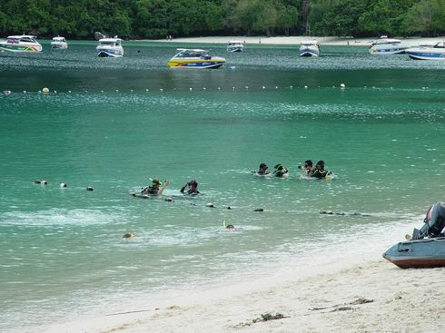
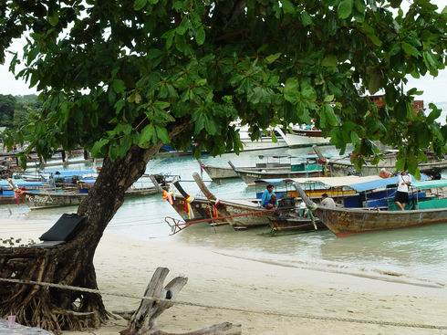
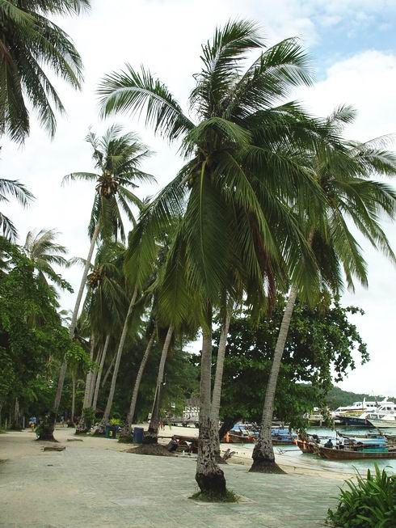
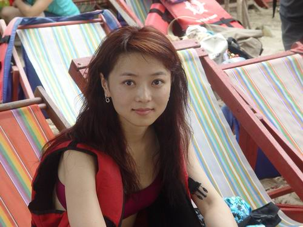
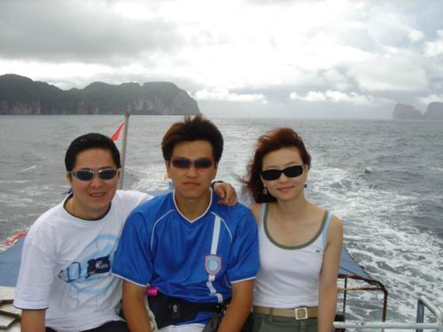
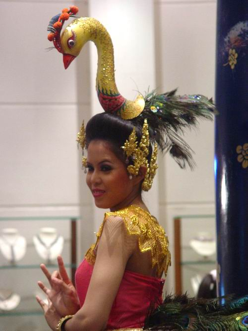
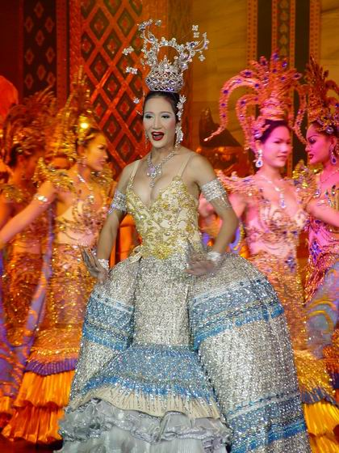
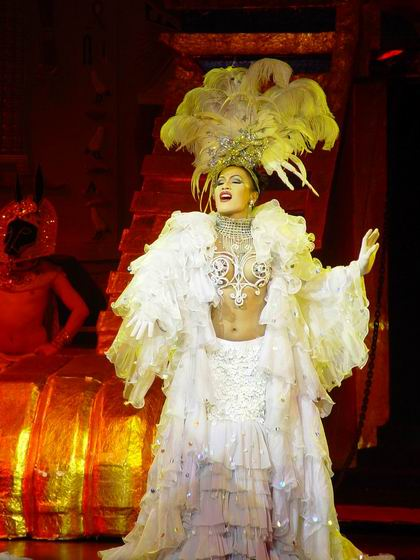
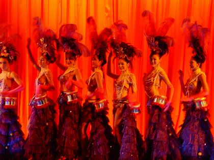

# 旅游，静心无为真境界

下笔写之前，我在想......什么时候我才能对自己的生活没有太多的要求，对自己没有太多的要求，能做到这样可以令自己更加快乐，不是吗？！别总说我事多，不这样要求，我想我会死的。

鉴于普吉岛和新加坡的团体旅游体验，感慨起自助游的诸多好处来。无论行程安排的如何浅显，自助游都可以深入当地人最平实的生活节目里，即使是最基本的乘车、吃饭、住宿、问路、泡吧...亦都是对于那个地方的一种最为亲近的了解过程，能够在回忆里闪烁出可爱的光彩！

我还清楚地记得在法国尼斯餐厅里遇见的挪威老年夫妇，记得他们和蔼的笑容以及他们对80年代访问中国的幽默描述；脑海里还清楚再现2003年大年29和另外三个新认识的旅人包车从丽江前往泸沽湖大雪纷飞的惊险旅程......这些都能令我又一次感受到旅行的快乐！

   
**Phi Phi Island**

有篇文章是这样写的：8天5国欧洲游，只游了14小时  
我曾参团旅行欧洲，8天游览了法国、德国、荷兰、比利时和卢森堡五个国家。朋友说我太赚了，一下子“进帐”5个。我沾沾自喜，但后来细算，惊得我差点从床上掉下来，从此再也不好意思说：“我游过欧洲”之类的话了。

行程表时间：8天，24X8=192小时。  
实际旅行时间：  
1、国内驻地往返机场2小时，国外机场往返驻地2小时，共约4小时。  
2、候机（往返）约6小时（旅行社要求提前2小时以上到机场集合）。  
3、乘机（北京巴黎往返）共约22小时。  
4、旅行中乘大巴：每天平均6小时X6天=36小时。  
5、进酒店休息：每天平均12小时X6天=72小时。  
6、午饭及晚饭：每天平均2小时X6天=12小时左右。  
7、游览时间：192小时-174小时=18小时。  
真是不算不知道，一算吓一跳啊！这样再除去购物时间约4小时，实际游览时间仅仅剩下14个小时，平均每天不到3小时！按欧洲“8天5国游”团单，实际游览时间只占7%！按旅行费用12000元人民币（交旅行社的）计算，在欧洲实际游览一小时要花857元！

后来我又做了一次为期8天的德国旅行，每到一个城市都能碰到几个德国同行，我总回问他们：“你们到过中国旅行吗？”90%的德国人回答：“没有。”我接着问：“WHY NOT？”答案惊人的一致，几乎所有的回答都是：“中国太大太美，至少需要旅行一个月才能品到一点原汁原味，如果只有两周假期，根本不够。这或许就是我们总能在街头看到身背近一人高的背包“外国驴”手拿地图边走边看，而在欧洲城市街头总能看到跟在举着小旗的导游后的中国团的原因了。

旅行消费学问太大了，很重要的一点是我们要清楚自己真正从旅行中得到了什么，看过了“红磨房”的艳舞不算到过巴黎，在蒙马特泡一个晚上，在塞纳河畔逛过一天，在卢浮宫转过一圈，才算摸过巴黎的裙褶。

我们从大PP岛返回普吉岛的船上遇见一对美国年轻夫妇，他们二人旅行一个月，从中国的云南、越南一路到了泰国的普吉岛，大约花费了USD2000.00的费用，他们微笑的时候面孔非常迷人，是的，我们中国人还需要锻炼微笑的能力！当时我就想在中国什么样的工作可以每年出去旅行一个月的时间呢？教师？搞艺术的人？还是自由职业者？人家旅行是为了享受休闲或是寻求生活差异，人家可以在街头咖啡屋消磨一个下午，我们则象一群幼稚的孩子跟着“导游阿姨”还没看清楚景点，就急着照“到此一游”，脚步永远是急的，正如心永远是浮的。

旅游是精神文化消费品，如果我们的旅行是”上车睡觉、下车拍照，回来一问什么都不知道“，那么，我们不仅糟蹋了那些名胜古迹、秀美山川、说严重一点是暴殄天物。普吉岛适合休闲度假，我们最初的愿望也是这样的，说的直白些就是“玩”去的，然而行程安排俨然是观光模式，却又无观光内容，还不如去曼谷和巴提雅。普吉岛是泰国众多岛屿中面积最大的一个岛屿，周围拥有39座离岛，合计面积约578平方公里，人口18万左右。5天，在这座岛屿上所体会到的就是不停的上车下车，不断地上船下船...这不是一次旅行，更不是一个休闲的过程，连去海滩玩耍也被规定了时间，我们的思维思想及感受被剥夺在无汁无味中.....  
   
   
   

   
   
   

---

## 评论（1）

**[marcoyang](http://qclb.blogdriver.com)** · 2004-08-04

脚步永远是急的，正如心永远是浮的.  
  
写得真好！:smile:

