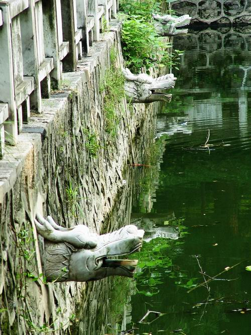
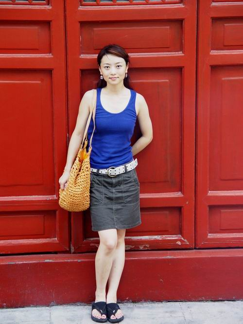
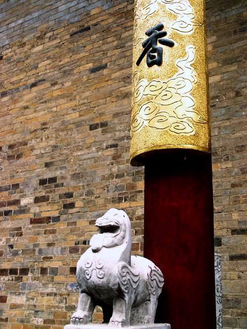
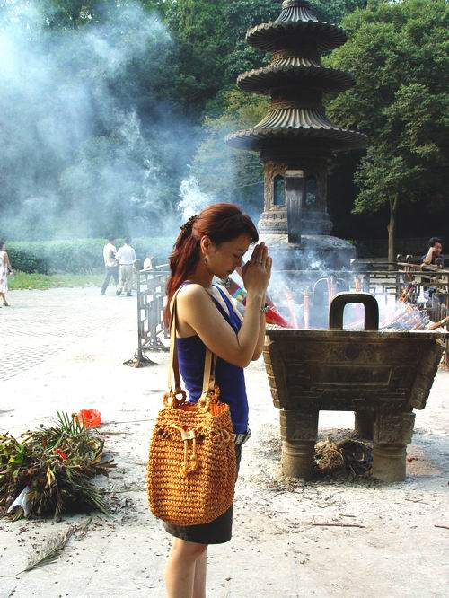

# 简简单单迈入30岁

生日这天第二次去栖霞古寺，物是人非。  
上一次是94、95年的时候骑自行车去的。烧了五柱香燃了两只红烛，简单吃了个晚饭，这天就算过去了。

1、**栖霞古寺放生池**  

2、**朱红柳绿**  

3、**守你一万年**  

4、**上苍知道......**  

---

## 评论（6）

**IPneer** · 2004-08-16

啊，栖霞古寺的样子不错哦，有机会我也去那边看看。台湾佛光山的星云大师是我比较喜欢的法师之一，他就是出自栖霞寺的，后来随国民党去到台湾，佛光山现在在佛教的影响力是蛮大的哦。

**jerryymjin** · 2004-08-17

建议Christina:oops::oops:以后去寺庙的话，最好不要穿裙子，长裤比较好:wink::wink::wink:

**jiajialing** · 2004-08-17

简简单单迈入30岁,简简单单的生活,轻松一点.:wink:

**[花浪无影](http://kent.k900.com/)** · 2004-08-17

无意中闯进了你的生活中，图片的点点滴滴，文字的点点滴滴，都让我觉的感动，亲切。心情随着你的脚步，缓缓的进入另一种状态，谢谢你让我在深夜中，感到一丝丝别样的暖意！！

**[花浪无影](http://kent.k900.com/)** · 2004-08-17

:razz:要睡了，晚安！！！期待你的杰作

**chen** · 2005-06-13

好想在那里见过你

