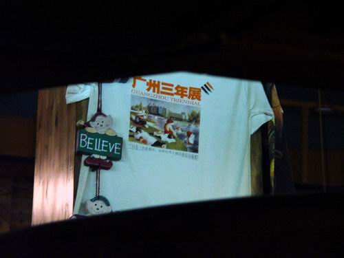

# 闻到秋天的味道

晚上妈妈送来三十个饺子、虾和红烧鸡块。

于是，下班后回家吃饭。

妈妈突然有些激动地和我谈起一些往事儿，她那种优柔的态度深深影响着她的儿女们。她谈论的那回子事儿，我和我的女友们在近期才不约而同地达成共识，比妈妈意识到要早几十年，这是社会的进步还是女人们的进步？女友说：“今天上厕所的时候一阵难过，难过的都想哭。一出来就正常了。只是喉咙发哽而已，心有点痛的感觉，但是泪却流不下来。”其实，看清楚事物本质，承认并接受现实，还有什么可痛苦的？这是我最近的总结。我也有女友说的那种感受，那种酸涩，可是没什么值得哭的。

三伏天结束，晚上不用开着空调睡觉了，傍晚时分隐约闻得到秋天的味道。当食物开始给你享受的感觉时，不可抑制的是体重的增加，大概两个月时间我迅速增长了4斤。尤其喜欢吃麦当劳的炸薯条，每次都会买双份。还有什么比吃炸薯条更令人愉快的事呢？

---

## 评论（5）

**[埯姬](http://angie.tecinese.com)** · 2004-08-20

大彻大悟

**[asiapan](http://asiapan.blogbus.com)** · 2004-08-21

麦当劳不是有一个广告说，“分享很容易，除了麦当劳薯条”，:mrgreen:

**christina** · 2004-08-21

是吗？呵呵，这么一说又想吃薯条了！

**rebaca** · 2004-08-21

是什么感悟呢？:?:

**jim** · 2004-09-02

是不是开始担心自己变老了？嗬嗬，岁月无情啊。不过呢，开心的女人是最吸引人的女人。  
我想很多人欣赏的是你的这点吧。

