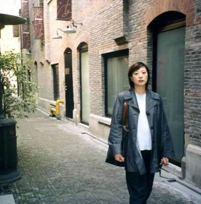

# 北京女病人的Photo

一定有很多人喜欢[北京女病人](http://www.blogcn.com/char/lome.asp)的文字，今天Blogcn登出了她的照片，我很自然的想到Blogcn速度狂慢的原因和这个有关。

我和我的女友们一样都喜欢看她的文字，但最近没看了，不是刻意的也不是不想，就那么自然的事儿。也许和心情有关？上个月买了她的《病忘书》，读完后整个“看透”了，当然她文字表达和我平时嘴上说的或者意愿上希望的那种“看透”是两个概念。我所谓的“看透”有点口是心非的味道， 而北京女病人俨然是悠然自得的接受被看透的世界，并且能从中体味着乐趣......

有一次和朋友谈论到女病人，此君曰：“这个女人都是人精了，哪个男人敢要？”我恍悟：原来男人们都喜欢傻女人？希望女人比他们愚蠢。这是否是男人过于自卑的原因呢？

*北京女病人自我介绍如下*：

俺有很多很多心事儿，积得时间长了，就变成了心病。

俺没有钱去看心理医生，也没指望能遇见个《无间道》里那样妩媚多姿的心理医生，最主要的是俺不大相信心理医生。因为俺自己读完了弗洛依德啊荣格啊马斯洛啊什么的，俺知道自己的病症在哪儿。但是束手无策。

所以，俺开始写博客。哪怕是做一份病理档案出来也是好的。同是天涯沦落人，这个世界上一定也有很多过得不那么开心的人，事实上，没有什么人能永远快乐。

有句话说，幽默感从来和幸福无关。或许它只是俺们自我解嘲的工具。如果一个人每天拉长了脸做悲伤状幽怨状好象所有人都欠他钱，这么下去的话早晚神憎鬼厌。所以，那么心里哀伤，脸上也要挂着笑容，在惨淡的人生里寻找一些珍贵的快乐。所谓就着蜜糖吃毒药，就是如此吧。

整个博客日记乱七八糟，什么内容都有，想到哪儿说到哪儿。俺不希望被某一种风格束缚住，现实无非就是那个样子，但是在网络上，在精神世界中，一个人是可以随心所欲并且极大丰富的。这是俺们渴望的状态。

回顾一年来写博的经历，翻看从前写下的文字。俺发现博客完全记录了一个人的成长历程。生活已经在不知不觉中发生了变化。

在博客上，首次验证了“六个分离度”的理论。基本上，想和世界上任何一个人发生联系，从理论上说通过六个人就可以实现。于是兜兜转转，在博客上认识了一大票好朋友。无论是网络上还是现实中，这些人都走到一起，互相关注鼓励，让人觉得这个世界上并不是一个人的孤单。

翻看那些文字，看到自己的心路历程是在如何变化。从最初的愤怒、压抑、扭曲，到后来的平和、宽容、宁静。它记载了一条美丽的抛物线。我们最后都会和这个世界和解。

网络可以改变人的生活状态。从一个大学老师到银行职员再到某投资公司的项目管理人员，因为博客的原因，现在做成了一个和文字有关的自由职业者。生活其实满神奇的不是吗。不过能自由的做着自己喜欢的事情，想一想其实很快乐。

《病忘书》，已经由天津人民出版社结集出版。内容选编自03年8月到04年2月的搏客日记。至于这个，已经算意外之喜了。

个人BLOG： <http://www.blogcn.com/User2/lome/index.html>
